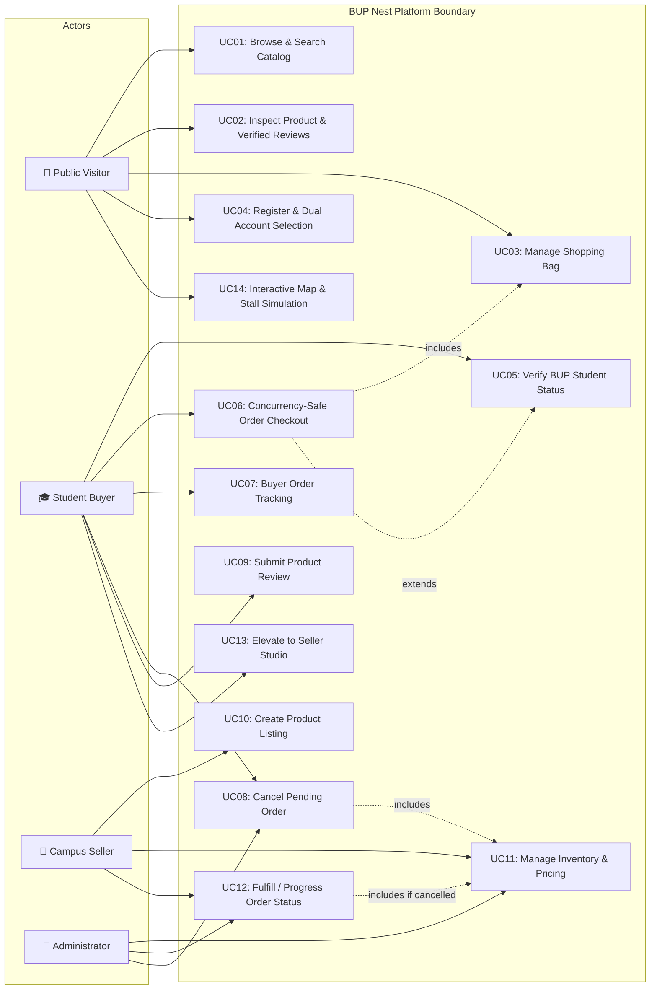
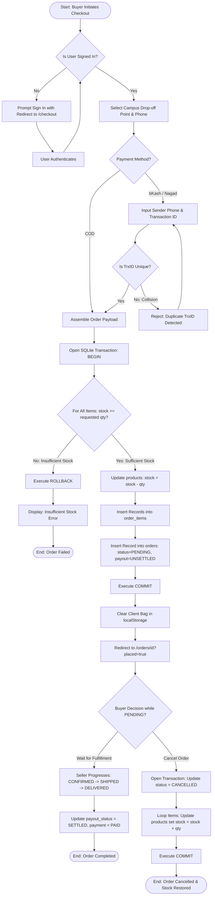
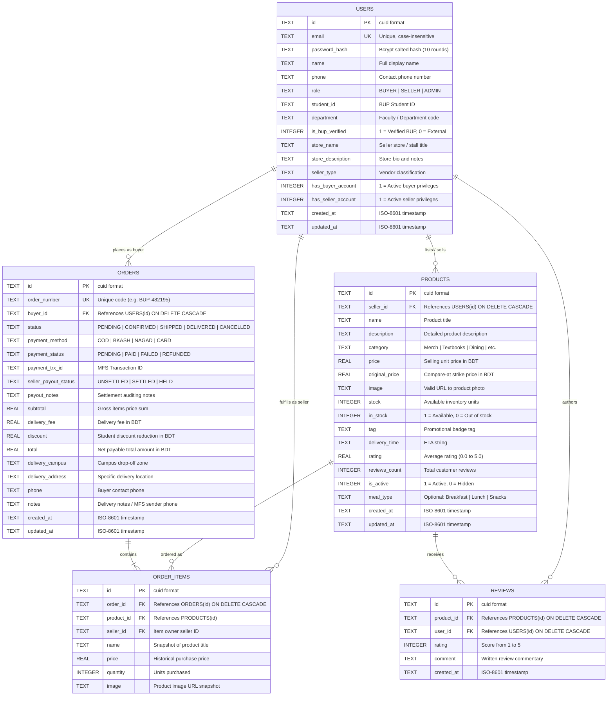
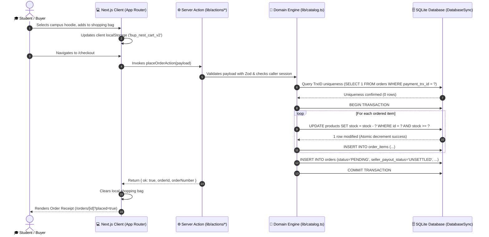
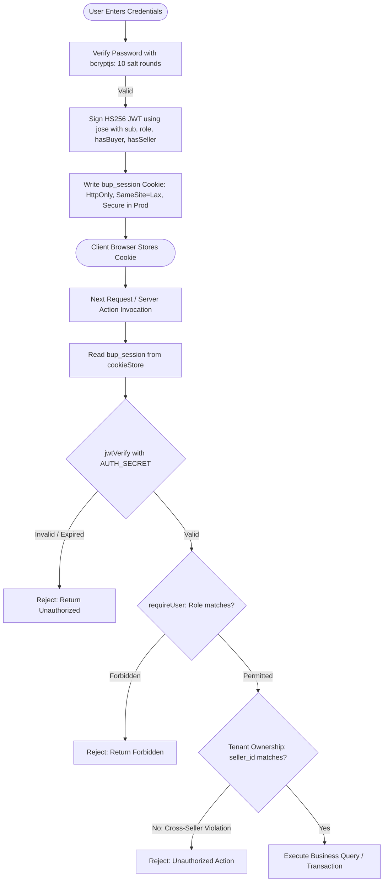

# BANGLADESH UNIVERSITY OF PROFESSIONALS (BUP)
## FACULTY OF SCIENCE AND TECHNOLOGY
### DEPARTMENT OF [DEPARTMENT NAME]

<br><br>

# PROJECT REPORT
### ON
# **BUP NEST: MULTI-VENDOR CAMPUS MARKETPLACE AND SPATIAL HUB**

<br>

**Course Title:** Web Technology Lab  
**Course Code:** [COURSE CODE]  

<br><br>

**Submitted To:**  
**[TEACHER NAME]**  
[DESIGNATION]  
Department of [Department Name]  
Faculty of Science and Technology  
Bangladesh University of Professionals (BUP)  

<br>

**Prepared By:**  
**[STUDENT NAME]**  
Student ID: [ID]  
Section: [SECTION]  
Batch: [BATCH]  

*[Second Student Name and Details, if applicable]*  

<br>

**Date of Submission:** [DATE]  

---

<div style="page-break-after: always;"></div>

# ABSTRACT

The expansion of collegiate ecosystems and university campus communities has led to a surge in localized micro-commerce, encompassing the exchange of academic course materials, institutional varsity apparel, departmental club merchandise, and decentralized cafeteria dining. At Bangladesh University of Professionals (BUP), located in Mirpur Cantonment, Dhaka, these exchanges have historically operated through fragmented, unvetted communication channels such as social media messaging groups and informal bulletin boards. These informal methods lack inventory tracking, transaction atomicity, verified customer reviews, and reliable order fulfillment.

This report presents **BUP Nest**, an enterprise-grade, multi-vendor electronic commerce platform and interactive campus spatial management system engineered specifically for the BUP academic community. The system is architected using the modern Next.js 16.4.0 full-stack framework with React 19 Server Components and Server Actions, styled using Tailwind CSS v4, and backed by Node.js’s high-performance native embedded relational engine (`node:sqlite`). BUP Nest implements an independent dual-account architecture where users can seamlessly maintain distinct Buyer and Seller profiles under a unified single sign-on credential. Core platform capabilities include verified BUP student status identification (yielding automated 5% academic discounts and delivery waivers), atomic transactional inventory decrementing (`BEGIN...COMMIT`) with concurrency collision rejection, automatic stock restoration upon order cancellation, platform-level escrow decoupling (`seller_payout_status`), and an interactive vector SVG architectural blueprint of the Mirpur Cantonment campus featuring lakeside pop-up stall reservation simulation. Cryptographic security is established via salted `bcryptjs` password hashing and HS256-signed JSON Web Tokens (`jose`) encapsulated within tamper-resistant HTTP-only cookies. Empirical quality assurance verified the system through an automated 10-point end-to-end integration test suite and sub-second production page generation across 18 distinct application routes.

**Keywords:** Multi-Vendor Marketplace, Campus Commerce, Next.js Server Actions, SQLite Concurrency, Atomic Inventory Control, Academic Discount Automation, Spatial Campus Blueprint.

---

<div style="page-break-after: always;"></div>

# TABLE OF CONTENTS

- **Abstract**
- **List of Figures**
- **List of Tables**
- **List of Abbreviations**

### **CHAPTER 1: INTRODUCTION**
- 1.1 Overview
- 1.2 Background and Motivation
- 1.3 Problem Statement
- 1.4 Project Objectives
- 1.5 Outline of the Report

### **CHAPTER 3: SYSTEM ANALYSIS AND MODELING**
- 3.1 Overview
- 3.2 Use Case Diagram
  - 3.2.1 Use Case Descriptions
    - 3.2.1.1 UC01: Browse and Filter Catalog
    - 3.2.1.2 UC04: User Registration and Dual Account Selection
    - 3.2.1.3 UC06: Concurrency-Safe Order Checkout
    - 3.2.1.4 UC08: Buyer Self-Service Order Cancellation
    - 3.2.1.5 UC10: Create Product Listing
    - 3.2.1.6 UC12: Multi-Vendor Order Fulfillment and Settlement
- 3.3 Activity Diagram
- 3.4 Entity Relationship (ER) Diagram
- 3.5 System Workflow

### **CHAPTER 4: SYSTEM DESIGN AND IMPLEMENTATION**
- 4.1 Overview
- 4.2 Methodology
- 4.3 System Architecture
- 4.4 Technology Stack
- 4.5 Database Design
- 4.6 Security and Privacy Design
- 4.7 Concurrency Control and Multi-Vendor Settlement Engine
- 4.8 User Interface Design
- 4.9 System Module Implementation
  - 4.9.1 Module 1: Authentication & Multi-Role Identity Module
  - 4.9.2 Module 2: Catalog Browsing & Search Engine Module
  - 4.9.3 Module 3: Persistent Client Shopping Bag Module
  - 4.9.4 Module 4: Concurrency-Safe Order Processing Module
  - 4.9.5 Module 5: Multi-Vendor Seller Studio & Fulfillment Module
  - 4.9.6 Module 6: Campus Architectural Experience & Stall Hub
- 4.10 Application Programming Interface (API) & Server Actions
- 4.11 Major System Functionalities
- 4.12 Data Used in the Prototype
- 4.13 Testing and Verification
- 4.14 System Configuration and Deployment

### **CHAPTER 5: CONCLUSION AND FUTURE WORK**
- 5.1 Project Summary
- 5.2 Project Outcomes and Achievements
- 5.3 Project Limitations
- 5.4 Future Work

### **REFERENCES**

---

<div style="page-break-after: always;"></div>

# LIST OF FIGURES

- **Figure 3.1:** UML Use Case Diagram of BUP Nest Platform
- **Figure 3.2:** UML Activity Diagram for Order Placement, Concurrency Control, and Cancellation
- **Figure 3.3:** Entity-Relationship (ER) Diagram of Relational Database Schema
- **Figure 3.4:** End-to-End System Workflow Sequence Diagram
- **Figure 4.1:** High-Level Layered System Architecture Diagram
- **Figure 4.2:** Authentication and Session Security Token Lifecycle
- **Figure 4.3:** Concurrency Control and Inventory Restoration Logic Flow
- **Figure 4.4:** Campus Hub and Workspace Navigation Interface
- **Figure 4.5:** Interactive Vector SVG Architectural Campus Masterplan
- **Figure 4.6:** Lakeside Promenade Stalls and Reservation Section
- **Figure 4.7:** Public Product Catalog with Dynamic Category Filters and Search
- **Figure 4.8:** Product Detail Page with Verified Ratings and Instant Purchase Action
- **Figure 4.9:** Verified Customer Reviews and Dynamic Rating Recalculation Form
- **Figure 4.10:** Dedicated Shopping Cart Manager with Real-Time Subtotal Computation
- **Figure 4.11:** Order Checkout with Automated BUP Student Discount and Delivery Fee Waiver
- **Figure 4.12:** Mobile Financial Services (bKash/Nagad) Payment Verification Interface
- **Figure 4.13:** Buyer Order Tracking History Dashboard with Fulfillment Badges
- **Figure 4.14:** Detailed Order Invoice Receipt with Self-Service Cancellation Trigger
- **Figure 4.15:** Multi-Vendor Seller Studio Dashboard with Sales KPI Metrics
- **Figure 4.16:** Seller Order Fulfillment Interface with State Progression Action Controls
- **Figure 4.17:** Product Creation Interface with Preset Image Picker and Stock Controls
- **Figure 4.18:** User Registration Interface with Segmented Dual-Role Account Picker

---

<div style="page-break-after: always;"></div>

# LIST OF TABLES

- **Table 3.1:** Use Case Description for UC01 (Browse and Filter Catalog)
- **Table 3.2:** Use Case Description for UC04 (User Registration and Role Selection)
- **Table 3.3:** Use Case Description for UC06 (Concurrency-Safe Order Checkout)
- **Table 3.4:** Use Case Description for UC08 (Buyer Order Cancellation)
- **Table 3.5:** Use Case Description for UC10 (Create Product Listing)
- **Table 3.6:** Use Case Description for UC12 (Order Fulfillment and Settlement)
- **Table 4.1:** Comprehensive Technology Stack and Implementation Rationale
- **Table 4.2:** Database Schema Specification for `users` Table
- **Table 4.3:** Database Schema Specification for `products` Table
- **Table 4.4:** Database Schema Specification for `orders` Table
- **Table 4.5:** Database Schema Specification for `order_items` Table
- **Table 4.6:** Database Schema Specification for `reviews` Table
- **Table 4.7:** Database CRUD Operations Implementation Mapping
- **Table 4.8:** Access Control and Role-Based Permissions Matrix
- **Table 4.9:** Master API Endpoint and Server Actions Specification
- **Table 4.10:** Pre-Configured Campus Demonstration Accounts
- **Table 4.11:** Automated End-to-End Test Execution and Verification Results
- **Table 4.12:** Environment Variables and Configuration Attributes

---

<div style="page-break-after: always;"></div>

# LIST OF ABBREVIATIONS

- **ACID:** Atomicity, Consistency, Isolation, Durability
- **API:** Application Programming Interface
- **BDT:** Bangladeshi Taka (৳)
- **BUP:** Bangladesh University of Professionals
- **COD:** Cash on Delivery
- **CSRF:** Cross-Site Request Forgery
- **CVA:** Class Variance Authority
- **DOM:** Document Object Model
- **ER:** Entity-Relationship
- **FASS:** Faculty of Arts and Social Sciences
- **FBS:** Faculty of Business Studies
- **FSSS:** Faculty of Security and Strategic Studies
- **FST:** Faculty of Science and Technology
- **HTTP:** Hypertext Transfer Protocol
- **HTTPS:** Hypertext Transfer Protocol Secure
- **ICE:** Information and Communication Engineering
- **JSON:** JavaScript Object Notation
- **JWT:** JSON Web Token
- **KPI:** Key Performance Indicator
- **MFS:** Mobile Financial Services
- **ORM:** Object-Relational Mapping
- **RBAC:** Role-Based Access Control
- **RPC:** Remote Procedure Call
- **RSC:** React Server Components
- **SPA:** Single Page Application
- **SQL:** Structured Query Language
- **SVG:** Scalable Vector Graphics
- **TrxID:** Transaction Identifier
- **UI:** User Interface
- **UML:** Unified Modeling Language
- **URL:** Uniform Resource Locator
- **UX:** User Experience
- **XSS:** Cross-Site Scripting

---

<div style="page-break-after: always;"></div>

# CHAPTER 1: INTRODUCTION

## 1.1 Overview
The digital transformation of university campuses has accelerated beyond conventional learning management systems into integrated campus life and hyper-local commercial platforms. University campuses constitute self-contained micro-economies characterized by high transaction frequency, specialized commodity demands, recurrent physical interaction points, and unique community trust boundaries. At Bangladesh University of Professionals (BUP), situated within the Mirpur Cantonment military-educational zone, thousands of students, faculty members, administrative staff, and authorized commercial vendors interact daily across academic faculties, residential zones, central canteens, and the prominent BUP Lake Promenade.

**BUP Nest** is a full-stack, multi-vendor electronic commerce web platform and interactive campus life hub developed specifically to meet the academic, commercial, and spatial management requirements of the BUP community. Developed as part of the Web Technology Lab curriculum, the system combines modern software architecture with robust engineering practices to deliver a secure, responsive, and concurrency-safe web application. The platform provides verified student buyers with authenticated campus trade, automated academic discounts, localized delivery coordination, and real-time order tracking, while providing student entrepreneurs, institutional clubs, and commercial cafeteria operators with autonomous digital storefronts, inventory tracking, and fulfillment workflow management.

## 1.2 Background and Motivation
University campuses foster a dynamic environment of informal student enterprise and resource circulation. On any given semester, undergraduate and postgraduate students require course-specific textbooks, scientific calculators, laboratory equipment, engineering drawing instruments, batch-customized apparel, and event merchandise. Concurrently, student organizations such as the BUP Robotics Club, the Cultural Forum, and the Business & Communication Club regularly produce merchandise, host competitions, and curate seasonal pop-up stalls. Furthermore, campus dining facilities—including the Central Canteen and the Lakeside Promenade Cafe—experience extreme demand surges during brief 15-minute inter-lecture class intervals.

Historically, this trade has been conducted through unstructured channels, primarily student Facebook groups, peer-to-peer messaging applications, and physical notice boards. These informal approaches exhibit severe systemic liabilities:
1. **Transaction Insecurity & Counterfeiting:** Buyers face financial vulnerability when pre-paying peers via personal mobile financial accounts without escrow protection or purchase receipts.
2. **Severe Canteen Queuing Bottlenecks:** Physical order placement and cash disbursement during high-traffic class breaks overwhelm cafeteria counters, leading to unserved students and food wastage.
3. **Inventory Mismanagement & Overselling:** Student vendors advertising limited batches of hoodies or textbooks manually record requests, inevitably leading to double-allocation, overselling, and customer dissatisfaction.
4. **Opaque Physical Stall Allocation:** University festivals and club expos require physical space along the BUP Lake Promenade and Academic Plaza. The manual administrative allocation process lacks visibility into spatial dimensions, utility access, footfall data, and reservation tracking.

The motivation behind developing BUP Nest is to replace these uncoordinated, error-prone manual interactions with a centralized, enterprise-grade software system. By leveraging modern web technologies—specifically React Server Components, Server Actions, relational transactions, and role-based access control—BUP Nest bridges the gap between campus spatial reality and digital commerce.

## 1.3 Problem Statement
The absence of a centralized, secure, and university-aware digital marketplace at BUP results in notable operational inefficiencies for all campus stakeholders:
- **For Student Buyers:** Lack of a verified, searchable catalog for academic supplies; absence of structured student discount mechanisms; vulnerability to unverified sellers; and inability to track order progression from preparation to campus delivery.
- **For Student Vendors & Clubs:** High barriers to launching an online storefront; absence of inventory management tools; inability to process structured digital payments; and risk of concurrent overselling during checkout spikes.
- **For Campus Dining Operators:** Inability to accept meal pre-orders; severe counter crowding during academic class intervals; cash handling delays; and lack of daily sales analytics.
- **For Event Organizers & Administration:** Manual, unmapped physical stall booking processes along campus promenades lacking architectural coordinate visibility, footfall metrics, and reservation auditing.

Existing commercial platforms (e.g., Daraz, Chaldal, Foodpanda) fail to resolve these issues because they operate on broad metropolitan logistics frameworks, enforce steep merchant commission fees, lack integration with university student identification, and cannot accommodate hyper-local campus drop-off points (such as "Vista Hall Gate 2" or "FST Academic Wing"). Consequently, a dedicated, campus-tailored software solution is imperative.

## 1.4 Project Objectives
The overarching objective of the BUP Nest project is to design, implement, and verify a multi-vendor campus electronic commerce and spatial management platform tailored to the operational realities of Bangladesh University of Professionals.

### Specific Project Objectives:
1. **Dual-Role Account Architecture:** Engineer an authentication system that enables users to operate independently as Buyers, Sellers, or dual Connected Accounts under a single sign-on credential without forcing unwanted role enrollment.
2. **Automated Academic Verification & Benefits:** Implement automatic verification for institutional `@bup.edu.bd` email holders and verified Student ID numbers, programmatically applying 5% order discounts and campus delivery fee waivers.
3. **Concurrency-Safe Atomic Inventory Engine:** Develop an inventory management engine utilizing SQLite transactions (`BEGIN...COMMIT`) and conditional updates (`WHERE stock >= ?`) to guarantee zero overselling during simultaneous checkouts, paired with automatic stock recovery upon order cancellation.
4. **Decoupled Financial Settlement & Fraud Prevention:** Design a multi-method payment processor (COD, bKash, Nagad, Card) enforcing unique Transaction ID (TrxID) validation to reject duplicate submissions, while separating customer payments from vendor liability via platform escrow tracking (`seller_payout_status`).
5. **Multi-Vendor Seller Studio:** Build an operational seller management dashboard providing real-time Key Performance Indicators (gross sales, active listings, incoming orders), complete product CRUD capabilities, and order fulfillment state progression.
6. **Campus Spatial Visualization & Stall Hub:** Construct an interactive vector SVG architectural blueprint of the BUP Mirpur Cantonment campus, integrating lakeside pop-up stall displays, footfall analytics, and simulated reservation workflows.
7. **Production Optimization & Rigorous QA:** Verify the platform through automated end-to-end integration testing, strict TypeScript compilation, and sub-second static page generation under the Next.js Turbopack compiler.

## 1.5 Outline of the Report
The remainder of this report is structured as follows:
- **Chapter 3: System Analysis and Modeling:** Details the formal requirements analysis, system actors, Unified Modeling Language (UML) use case diagrams with detailed textual specifications, behavioral activity diagrams, Entity-Relationship (ER) relational data models, and the comprehensive system workflow.
- **Chapter 4: System Design and Implementation:** Presents the comprehensive technical implementation, software development methodology, multi-tier system architecture, technology stack breakdown, physical database schema design, security and cryptographic mechanisms, custom concurrency and payout algorithms, user interface screenshots, modular implementation specifics, API and Server Action references, testing methodologies, and deployment procedures.
- **Chapter 5: Conclusion and Future Work:** Summarizes project achievements, reviews demonstrated technical milestones, addresses architectural and functional limitations, and identifies realistic future enhancement trajectories.
- **References:** Lists formal academic papers, industry standards, and official framework documentation cited throughout the report using the IEEE numerical referencing style.

---

<div style="page-break-after: always;"></div>

# CHAPTER 3: SYSTEM ANALYSIS AND MODELING

## 3.1 Overview
System analysis and modeling constitutes the foundational engineering phase wherein domain problems are translated into structured, unambiguous technical models. This chapter analyzes the functional dynamics of the BUP Nest platform through established software engineering methodologies. Using the Unified Modeling Language (UML), the system boundary, external human actors, operational use cases, behavioral state progressions, and structural database entities are systematically formulated. These models mirror the verified production codebase and ensure that implementation decisions correspond directly to architectural specifications.

## 3.2 Use Case Diagram
The use case model delineates the behavioral boundary of the BUP Nest application, capturing interactions between external actors and internal functional capabilities.

### System Actors:
1. **Public Visitor / Guest:** An unauthenticated user capable of exploring the public merchandise catalog, viewing product specifications, searching items, inspecting the campus architectural map, and populating a local client shopping bag.
2. **Student Buyer:** An authenticated student user possessing buyer privileges (`has_buyer_account = 1`). When verified through university credentials (`is_bup_verified = 1`), the actor gains automated 5% checkout discounts, free campus delivery, order placement, order tracking, order cancellation, and review submission privileges.
3. **Campus Seller:** An authenticated campus vendor, club official, or canteen concessionaire possessing active store privileges (`has_seller_account = 1`). This actor manages product catalogs, monitors inventory stock, tracks revenue metrics, and progresses order fulfillment states.
4. **System Administrator:** An executive administrative actor (`role = 'ADMIN'`) possessing global oversight, with authorization to override product visibility, audit financial payouts, and transition order fulfillment states across all campus stalls.


*Figure 3.1: UML Use Case Diagram of BUP Nest Platform.*

### 3.2.1 Use Case Descriptions

#### 3.2.1.1 UC01: Browse and Filter Catalog
*Table 3.1: Use Case Description for UC01.*

| Element | Specification |
|---|---|
| **Use Case ID** | UC01 |
| **Use Case Name** | Browse and Filter Catalog |
| **Primary Actor** | Public Visitor / Student Buyer |
| **Description** | Enables users to query active campus products by keyword, category, and sorting criteria without mandatory authentication. |
| **Preconditions** | System catalog must contain active products (`is_active = 1`). |
| **Main Flow** | 1. User navigates to `/shop`.<br>2. Server queries active products and renders product cards.<br>3. User inputs search keyword or selects category pill (e.g., "Merch", "Textbooks").<br>4. System filters records dynamically and sorts by price or rating.<br>5. Matching items are displayed with images, ratings, and BDT pricing. |
| **Alternative Flow**| If no products match the criteria, the system renders an empty state prompt with a reset filter button. |
| **Postconditions** | Filtered product catalog is displayed to the user. |

#### 3.2.1.2 UC04: User Registration and Dual Account Selection
*Table 3.2: Use Case Description for UC04.*

| Element | Specification |
|---|---|
| **Use Case ID** | UC04 |
| **Use Case Name** | User Registration and Dual Account Selection |
| **Primary Actor** | Unauthenticated Visitor |
| **Description** | Registers a new user, establishing whether they hold Buyer, Seller, or Connected Account privileges. |
| **Preconditions** | User must possess an unregistered, valid email address. |
| **Main Flow** | 1. Visitor opens `/register`.<br>2. Selects account type via segmented toggle: Buyer or Seller.<br>3. (Optional) Checks "Connect Both Accounts" to activate dual permissions.<br>4. Enters full name, email, password, and optional BUP Student ID.<br>5. Submits form to `registerAction`.<br>6. Server validates inputs, checks for duplicate email, hashes password with `bcryptjs`, and sets BUP verification flag if email ends with `@bup.edu.bd`.<br>7. User record is inserted into SQLite, JWT session cookie is issued, and user is redirected to the home dashboard. |
| **Alternative Flow**| If email already exists, server aborts with: *"An account with this email already exists"*. |
| **Postconditions** | User account created with assigned role flags; secure session initialized. |

#### 3.2.1.3 UC06: Concurrency-Safe Order Checkout
*Table 3.3: Use Case Description for UC06.*

| Element | Specification |
|---|---|
| **Use Case ID** | UC06 |
| **Use Case Name** | Concurrency-Safe Order Checkout |
| **Primary Actor** | Authenticated Student Buyer |
| **Description** | Finalizes cart lines, calculates verified academic discounts, validates digital MFS payment codes, and commits order under an atomic transaction. |
| **Preconditions** | User is signed in with `has_buyer_account = 1`; shopping cart contains at least 1 item. |
| **Main Flow** | 1. Buyer navigates from `/cart` to `/checkout`.<br>2. System validates session; if `is_bup_verified = 1`, applies 5% discount and sets delivery fee to ৳0.<br>3. Buyer selects campus delivery point and enters contact phone.<br>4. Selects payment method (COD, bKash, Nagad, Card).<br>5. If bKash/Nagad selected, buyer inputs sender phone and Transaction ID (TrxID).<br>6. Buyer clicks "Confirm Order", invoking `placeOrderAction`.<br>7. Server opens SQLite transaction (`BEGIN`).<br>8. Verifies TrxID uniqueness across `orders`.<br>9. Conditionally decrements inventory for each item (`UPDATE products SET stock = stock - ? WHERE id = ? AND stock >= ?`).<br>10. Inserts records into `orders` and `order_items`.<br>11. Commits transaction (`COMMIT`).<br>12. Cart is cleared from `localStorage`; buyer redirected to `/orders/[id]?placed=true`. |
| **Alternative Flow**| **A1 (Guest Access):** If visitor is unauthenticated, checkout presents a sign-in warning with a redirect URL preserving cart state.<br>**A2 (Overselling Collision):** If stock is insufficient, transaction triggers `ROLLBACK` and returns an error alerting the user.<br>**A3 (Duplicate TrxID):** If TrxID was previously submitted, order is rejected. |
| **Postconditions** | Order persisted with status `PENDING`; inventory decremented; receipt generated. |

#### 3.2.1.4 UC08: Buyer Self-Service Order Cancellation
*Table 3.4: Use Case Description for UC08.*

| Element | Specification |
|---|---|
| **Use Case ID** | UC08 |
| **Use Case Name** | Buyer Self-Service Order Cancellation |
| **Primary Actor** | Buyer Who Placed the Order |
| **Description** | Enables a customer to cancel an order still awaiting fulfillment, immediately replenishing inventory back to the marketplace. |
| **Preconditions** | Order status must strictly be `PENDING`; user must be the order owner. |
| **Main Flow** | 1. Buyer opens `/orders/[id]`.<br>2. Clicks "Cancel Order" on receipt interface.<br>3. Browser requests confirmation; buyer confirms.<br>4. Server opens SQLite transaction.<br>5. Updates `orders.status = 'CANCELLED'`.<br>6. Iterates through line items and increments `products.stock` by the purchased quantity, setting `in_stock = 1`.<br>7. Transaction commits; Next.js paths revalidated.<br>8. Receipt UI reflects `CANCELLED` status badge. |
| **Alternative Flow**| If seller already progressed the order to `CONFIRMED` or `SHIPPED`, server rejects cancellation: *"Order cannot be cancelled"*. |
| **Postconditions** | Order marked `CANCELLED`; product stock restored in database. |

#### 3.2.1.5 UC10: Create Product Listing
*Table 3.5: Use Case Description for UC10.*

| Element | Specification |
|---|---|
| **Use Case ID** | UC10 |
| **Use Case Name** | Create Product Listing |
| **Primary Actor** | Campus Seller / Admin |
| **Description** | Creates a new merchandise, textbook, or cafeteria product listing in the campus store. |
| **Preconditions** | User must possess `has_seller_account = 1` or `role = 'ADMIN'`. |
| **Main Flow** | 1. Seller navigates to `/seller/products/new`.<br>2. Inputs product title, category, description, unit price, stock count, and delivery ETA.<br>3. Selects preset image or inputs image URL.<br>4. Submits form via `createProductAction`.<br>5. Server validates fields with Zod schema, generates unique CUID, and inserts record linked to `seller_id`.<br>6. Seller redirected to `/seller` with new product listed in store inventory. |
| **Alternative Flow**| Validation failure (e.g. price $\le 0$ or title $< 3$ characters) displays inline error messages without losing form input. |
| **Postconditions** | Product listing created and made visible across `/shop` and `/api/products`. |

#### 3.2.1.6 UC12: Multi-Vendor Order Fulfillment and Settlement
*Table 3.6: Use Case Description for UC12.*

| Element | Specification |
|---|---|
| **Use Case ID** | UC12 |
| **Use Case Name** | Multi-Vendor Order Fulfillment and Settlement |
| **Primary Actor** | Campus Seller (Item Owner) / Admin |
| **Description** | Governs the fulfillment lifecycle of customer orders and triggers payout settlement upon verified delivery. |
| **Preconditions** | Seller must own the items contained in the order. |
| **Main Flow** | 1. Seller opens `/seller/orders`.<br>2. Locates order in `PENDING` state and reviews campus delivery location.<br>3. Advances status: `PENDING` $\rightarrow$ `CONFIRMED`.<br>4. Packs item and advances: `CONFIRMED` $\rightarrow$ `SHIPPED`.<br>5. Completes campus handover and marks: `SHIPPED` $\rightarrow$ `DELIVERED`.<br>6. Server sets `status = 'DELIVERED'`, updates `payment_status = 'PAID'`, and marks `seller_payout_status = 'SETTLED'`. |
| **Alternative Flow**| If vendor cannot fulfill, seller clicks `CANCELLED`. System triggers automated stock recovery transaction, returning item units back to inventory. |
| **Postconditions** | Order finalized; vendor payout settled; inventory adjusted if cancelled. |

## 3.3 Activity Diagram
The behavioral flow of order placement, concurrency control, and inventory recovery is modeled in the activity diagram below.


*Figure 3.2: UML Activity Diagram for Order Placement, Concurrency Control, and Cancellation.*

## 3.4 Entity Relationship (ER) Diagram
The persistence model of BUP Nest is structured as a relational database implemented on SQLite (`data/marketplace.db`). The conceptual schema defines five primary entities: `users`, `products`, `orders`, `order_items`, and `reviews`.


*Figure 3.3: Entity-Relationship (ER) Diagram of Relational Database Schema.*

## 3.5 System Workflow
The operational workflow coordinates client interactions, server processing, relational persistence, and state synchronization across the marketplace.


*Figure 3.4: End-to-End System Workflow Sequence Diagram.*

---

<div style="page-break-after: always;"></div>

# CHAPTER 4: SYSTEM DESIGN AND IMPLEMENTATION

## 4.1 Overview
This chapter presents the engineering architecture, implementation specifics, and technical methodologies governing the BUP Nest platform. It covers the full-stack architecture, physical database design, cryptographic security perimeter, custom concurrency control algorithms, user interface layouts, modular source code implementations, testing results, and production deployment parameters.

## 4.2 Methodology
The development of BUP Nest followed an **Iterative and Incremental Software Engineering Lifecycle**, structured across eight progressive phases:
1. **Domain & Requirements Analysis:** Conducting field interviews with BUP students, club executives, and canteen operators in Mirpur Cantonment to formulate functional and non-functional requirements.
2. **Architectural & Spatial Planning:** Designing the multi-workspace navigation framework and vector SVG blueprint of the BUP campus.
3. **Database & Relational Modeling:** Drafting relational schemas, foreign key constraints, unique indexes, and ACID transactional boundaries.
4. **Backend & Security Engineering:** Developing server actions, password hashing routines (`bcryptjs`), and JWT session cookie mechanics (`jose`).
5. **Frontend & Component Construction:** Building responsive UI components with React 19, Tailwind CSS v4, and Lucide React.
6. **Concurrency & Settlement Implementation:** Coding atomic inventory check-and-decrement logic, duplicate TrxID rejection, and escrow status decoupling.
7. **Verification & Quality Assurance:** Executing automated end-to-end integration test suites (`scratch/test_suite.ts`), static TypeScript compiler diagnostics, and Turbopack production builds.
8. **Deployment Configuration:** Documenting runtime prerequisites, PM2 process management, and Nginx reverse proxy configurations.

## 4.3 System Architecture
BUP Nest implements a **Modern Server-Driven Full-Stack Architecture** utilizing the **Next.js App Router (React Server Components + Server Actions)** model. Rather than employing a decoupled Single Page Application (SPA) communicating over REST/GraphQL with a standalone backend daemon, BUP Nest consolidates presentation, server-side business logic, authorization middleware, and database access into an integrated, type-safe full-stack application.

```mermaid
graph TD
    subgraph ClientLayer["🖥️ Presentation Layer (Client Browser)"]
        UI_Home["Landing & Hub (app/page.tsx)"]
        UI_Shop["Shop Catalog (app/shop/page.tsx)"]
        UI_Detail["Product Detail (app/product/[id])"]
        UI_Cart["Cart & Checkout (app/cart, app/checkout)"]
        UI_Seller["Seller Studio (app/seller/*)"]
        UI_Orders["Order History (app/orders/*)"]
        State_Cart["CartProvider (localStorage)"]
        State_Workspace["WorkspaceContext (React Context)"]
    end

    subgraph AppServer["⚙️ Next.js Application Server (Node.js Runtime)"]
        subgraph ServerComponents["React Server Components (RSC)"]
            RSC_Shop["ShopPage (Catalog Query)"]
            RSC_Detail["ProductDetailPage (Product & Reviews Query)"]
            RSC_Seller["SellerDashboard (Metrics & Orders)"]
            RSC_Orders["OrdersPage (Buyer Orders)"]
        end

        subgraph ServerActions["Server Actions (lib/actions/*)"]
            Act_Auth["auth.ts (login, register, elevate)"]
            Act_Orders["orders.ts (placeOrder, updateStatus, cancel)"]
            Act_Products["products.ts (create, update, delete, review)"]
        end

        subgraph RouteHandlers["HTTP Route Handlers (app/api/*)"]
            API_Products["GET /api/products"]
        end

        subgraph DomainLogic["Core Domain & Business Services (lib/*)"]
            Svc_Catalog["lib/catalog.ts (Transactions, Queries)"]
            Svc_Auth["lib/auth.ts (JWT Sign/Verify, Bcrypt)"]
            Svc_Seed["lib/seed.ts (Demo Data Seeder)"]
        end
    end

    subgraph PersistenceLayer["🗄️ Persistence Layer (File System / SQLite)"]
        DB_SQLite[("data/marketplace.db (SQLite Engine)")]
        Tables["Tables: users, products, orders, order_items, reviews"]
    end

    %% Client Interactions
    UI_Cart --> State_Cart
    UI_Home --> State_Workspace
    UI_Cart --> Act_Orders
    UI_Seller --> Act_Products
    UI_Seller --> Act_Orders
    UI_Detail --> Act_Products
    UI_Home --> API_Products

    %% Server Flow
    RSC_Shop --> Svc_Catalog
    RSC_Detail --> Svc_Catalog
    RSC_Seller --> Svc_Catalog
    RSC_Orders --> Svc_Catalog
    Act_Auth --> Svc_Auth
    Act_Auth --> Svc_Catalog
    Act_Orders --> Svc_Catalog
    Act_Products --> Svc_Catalog
    API_Products --> Svc_Catalog
    Svc_Catalog --> DB_SQLite
    DB_SQLite --- Tables
```


*Figure 4.1: High-Level Layered System Architecture Diagram.*

## 4.4 Technology Stack
All technologies and libraries utilized in BUP Nest were verified from configuration files and runtime outputs.

*Table 4.1: Comprehensive Technology Stack and Implementation Rationale.*

| Technology | Layer | Verified Version | Purpose & Implementation Details |
|---|---|---|---|
| **Next.js** | Framework | `16.4.0` | Core full-stack framework with Turbopack bundler, React Server Components (RSC), and Server Actions. Eliminates boilerplate REST routes. |
| **React** | UI Library | `^19.0.0` | Powers interactive UI components, hooks (`useTransition`, `useState`, `useEffect`), and streaming rendering. |
| **TypeScript** | Language | `5.7.3` | Enforces static type safety across database entities, mutation payloads, and UI component properties. |
| **Node.js SQLite**| Database | Native `node:sqlite` | Embedded relational database (`DatabaseSync` in Node v24). Guarantees zero-network-latency ACID transactions. |
| **Node.js** | Runtime | `v24.16.0` | Server runtime executing Turbopack, background actions, and native SQLite bindings. |
| **Tailwind CSS** | Styling | `^4.3.3` | Utility-first CSS framework compiled via `@tailwindcss/postcss`. Renders responsive layouts with zero CSS runtime bloat. |
| **jose** | Security | `^6.2.13` | Universal cryptography library generating and verifying HS256-signed JWT tokens in `lib/auth.ts`. |
| **bcryptjs** | Security | `^3.0.3` | Hashes user passwords with 10 salt rounds (`hashPassword`), defending against rainbow table attacks. |
| **Zod** | Validation | `^4.6.7` | Type-safe schema validation engine validating input forms across all server actions. |
| **Lucide React** | Iconography | `^1.16.0` | Renders clean, accessible SVG icons for navigation, rating stars, and badges. |
| **@base-ui/react**| UI Primitives| `^1.5.0` | Accessible unstyled primitives powering modal dialogues and drawers. |
| **pnpm** | Package Mgr | `12.3.4` | Disk-efficient package manager managing project dependencies. |

## 4.5 Database Design
The relational persistence layer is maintained within `./data/marketplace.db`. Foreign keys are strictly enforced upon database connection initialization via `PRAGMA foreign_keys = ON;`.

### Physical Table Schemas:

*Table 4.2: Database Schema Specification for `users` Table.*

| Column | Type | Nullable | Default | Description & Constraints |
|---|---|---|---|---|
| `id` | `TEXT` | NO | None | Primary Key (`cuid()`). |
| `email` | `TEXT` | NO | None | Unique constraint (`COLLATE NOCASE`). Primary identity. |
| `password_hash` | `TEXT` | NO | None | Bcrypt salted hash (10 rounds). |
| `name` | `TEXT` | NO | None | User's full display name. |
| `phone` | `TEXT` | YES | `NULL` | Contact telephone number. |
| `role` | `TEXT` | NO | `'BUYER'` | Primary role flag (`'BUYER'`, `'SELLER'`, `'ADMIN'`). |
| `student_id` | `TEXT` | YES | `NULL` | BUP Student ID (e.g., `22041108`). |
| `department` | `TEXT` | YES | `NULL` | Academic department code. |
| `is_bup_verified` | `INTEGER` | NO | `0` | `1` = Confirmed BUP student/faculty member. |
| `store_name` | `TEXT` | YES | `NULL` | Public store/stall title for sellers. |
| `store_description`| `TEXT` | YES | `NULL` | Store bio and operational guidelines. |
| `seller_type` | `TEXT` | YES | `NULL` | Vendor classification (e.g., `'Student Society'`). |
| `has_buyer_account`| `INTEGER` | NO | `1` | Flag enabling buyer market features. |
| `has_seller_account`| `INTEGER` | NO | `0` | Flag enabling seller studio features. |
| `created_at` | `TEXT` | NO | `(datetime('now'))` | Record creation timestamp. |
| `updated_at` | `TEXT` | NO | `(datetime('now'))` | Last modification timestamp. |

*Table 4.3: Database Schema Specification for `products` Table.*

| Column | Type | Nullable | Default | Description & Constraints |
|---|---|---|---|---|
| `id` | `TEXT` | NO | None | Primary Key (`cuid()` or seed ID). |
| `seller_id` | `TEXT` | NO | None | Foreign Key $\rightarrow$ `users(id)` ON DELETE CASCADE. |
| `name` | `TEXT` | NO | None | Product title ($\ge 3$ characters). |
| `description` | `TEXT` | NO | None | Product description ($\ge 5$ characters). |
| `category` | `TEXT` | NO | None | Categorical taxonomy (`Merch`, `Textbooks`, etc.). |
| `price` | `REAL` | NO | None | Unit price in BDT ($>0$). |
| `original_price` | `REAL` | YES | `NULL` | Compare-at strike-through price. |
| `image` | `TEXT` | NO | None | Valid URL to product image. |
| `stock` | `INTEGER` | NO | `0` | Available stock count ($\ge 0$). |
| `in_stock` | `INTEGER` | NO | `1` | `1` if stock $>0$, else `0`. |
| `tag` | `TEXT` | YES | `NULL` | Promotional badge (e.g., `'Winter Drop'`). |
| `delivery_time` | `TEXT` | NO | `'2-4 days'` | Estimated delivery timeframe. |
| `rating` | `REAL` | NO | `0` | Dynamic average rating (0.0 to 5.0). |
| `reviews_count` | `INTEGER` | NO | `0` | Total verified reviews count. |
| `is_active` | `INTEGER` | NO | `1` | `1` = Active in catalog, `0` = Hidden. |
| `meal_type` | `TEXT` | YES | `NULL` | For dining items: `'Breakfast'`, `'Lunch'`. |
| `created_at` | `TEXT` | NO | `(datetime('now'))` | Record creation timestamp. |
| `updated_at` | `TEXT` | NO | `(datetime('now'))` | Last modification timestamp. |

*Table 4.4: Database Schema Specification for `orders` Table.*

| Column | Type | Nullable | Default | Description & Constraints |
|---|---|---|---|---|
| `id` | `TEXT` | NO | None | Primary Key (`cuid()`). |
| `order_number` | `TEXT` | NO | None | Unique tracking code (e.g., `BUP-482195`). |
| `buyer_id` | `TEXT` | NO | None | Foreign Key $\rightarrow$ `users(id)` ON DELETE CASCADE. |
| `status` | `TEXT` | NO | `'PENDING'` | `'PENDING'`, `'CONFIRMED'`, `'SHIPPED'`, `'DELIVERED'`, `'CANCELLED'`. |
| `payment_method` | `TEXT` | NO | `'COD'` | `'COD'`, `'BKASH'`, `'NAGAD'`, `'CARD'`. |
| `payment_status` | `TEXT` | NO | `'PENDING'` | `'PENDING'`, `'PAID'`, `'FAILED'`, `'REFUNDED'`. |
| `payment_trx_id` | `TEXT` | YES | `NULL` | MFS Transaction ID (checked for uniqueness). |
| `seller_payout_status`| `TEXT` | NO | `'UNSETTLED'`| Platform escrow status: `'UNSETTLED'`, `'SETTLED'`. |
| `payout_notes` | `TEXT` | YES | `NULL` | Accounting settlement audit notes. |
| `subtotal` | `REAL` | NO | None | Gross line items sum. |
| `delivery_fee` | `REAL` | NO | `0` | Delivery charge in BDT. |
| `discount` | `REAL` | NO | `0` | Student discount reduction in BDT. |
| `total` | `REAL` | NO | None | Net payable amount in BDT. |
| `delivery_campus`| `TEXT` | YES | `NULL` | Campus drop-off zone. |
| `delivery_address`| `TEXT` | YES | `NULL` | Specific delivery point. |
| `phone` | `TEXT` | YES | `NULL` | Buyer telephone number. |
| `notes` | `TEXT` | YES | `NULL` | Delivery notes or MFS sender phone. |
| `created_at` | `TEXT` | NO | `(datetime('now'))` | Order placement timestamp. |
| `updated_at` | `TEXT` | NO | `(datetime('now'))` | Status update timestamp. |

*Table 4.5: Database Schema Specification for `order_items` Table.*

| Column | Type | Nullable | Description & Constraints |
|---|---|---|---|
| `id` | `TEXT` | NO | Primary Key (`cuid()`). |
| `order_id` | `TEXT` | NO | Foreign Key $\rightarrow$ `orders(id)` ON DELETE CASCADE. |
| `product_id` | `TEXT` | NO | Foreign Key $\rightarrow$ `products(id)`. |
| `seller_id` | `TEXT` | NO | Item owner seller ID. |
| `name` | `TEXT` | NO | Historical snapshot of product title. |
| `price` | `REAL` | NO | Historical unit purchase price. |
| `quantity` | `INTEGER`| NO | Units ordered. |
| `image` | `TEXT` | NO | Product thumbnail image URL snapshot. |

*Table 4.6: Database Schema Specification for `reviews` Table.*

| Column | Type | Nullable | Description & Constraints |
|---|---|---|---|
| `id` | `TEXT` | NO | Primary Key (`cuid()`). |
| `product_id` | `TEXT` | NO | Foreign Key $\rightarrow$ `products(id)` ON DELETE CASCADE. |
| `user_id` | `TEXT` | NO | Foreign Key $\rightarrow$ `users(id)` ON DELETE CASCADE. |
| `rating` | `INTEGER`| NO | Score between 1 and 5. |
| `comment` | `TEXT` | YES | Written review feedback text. |
| `created_at` | `TEXT` | NO | Submission timestamp. |
| **Constraint** | `UNIQUE` | - | `UNIQUE(product_id, user_id)`: Enforces one review per user per product. |

### CRUD Operations Implementation Mapping:

*Table 4.7: Database CRUD Operations Implementation Mapping.*

| Entity | Create (C) | Read (R) | Update (U) | Delete (D) |
|---|---|---|---|---|
| **Users** | `createUser()` (`lib/catalog.ts` L212) | `findUserByEmail()`, `findUserById()` (L202-210) | `updateUserProfile()`, `openSellerAccount()` (L486-537) | Cascaded via admin commands |
| **Products** | `createProduct()` (L60-93) | `listProducts()`, `getProduct()` (L9-58) | `updateProductWithOptions()` (L114-192) | `deleteProduct()` (L194-200) |
| **Orders** | `createOrder()` (L255-346) | `getOrder()`, `listBuyerOrders()`, `listSellerOrders()` (L348-392) | `updateOrderStatus()`, `cancelOrderByBuyer()` (L394-459) | Cascaded on buyer deletion |
| **Reviews** | `addOrUpdateReview()` (L562-598) | `listProductReviews()` (L549-560) | Handled by `ON CONFLICT` in `addOrUpdateReview()` | Cascaded on product/user deletion |

## 4.6 Security and Privacy Design
BUP Nest implements a multi-layered security model adhering to the principle of least privilege.


*Figure 4.2: Authentication and Session Security Token Lifecycle.*

### Cryptographic Implementation Highlights:
1. **Password Hashing:** Implemented in `lib/auth.ts` via `bcrypt.hash(password, 10)`. Plaintext passwords never persist to storage, session tokens, or log files.
2. **Session Integrity:** Implemented via `jose` (`SignJWT`). Tokens carry a 30-day expiration window (`.setExpirationTime('30d')`) and are delivered via HTTP-only cookies (`httpOnly: true`, `sameSite: 'lax'`), preventing client-side script extraction (mitigating XSS token theft).
3. **Role-Based Access Control (RBAC):** Server middleware `requireUser(['BUYER', 'SELLER', 'ADMIN'])` intercepts mutations.

*Table 4.8: Access Control and Role-Based Permissions Matrix.*

| Route / Resource | Public Guest | Verified Buyer | Campus Seller | Platform Admin |
|---|---|---|---|---|
| View Catalog (`/shop`, `/product/[id]`) | ✅ Read | ✅ Read | ✅ Read | ✅ Read |
| View Campus Map & Stalls (`/`, `/#stalls`)| ✅ Read | ✅ Read | ✅ Read | ✅ Read |
| Add Items to Bag / View Cart (`/cart`) | ✅ Manage | ✅ Manage | ✅ Manage | ✅ Manage |
| Checkout & Order Placement (`/checkout`)| ❌ Redirect | ✅ Submit | ✅ (If Buyer) | ✅ Submit |
| Buyer Order Tracking (`/orders`) | ❌ Forbidden | ✅ Own Orders | ✅ Own Orders | ✅ All Orders |
| Cancel Order (`cancelBuyerOrderAction`) | ❌ Forbidden | ✅ Own Orders | ✅ Own Orders | ✅ All Orders |
| Seller Studio Dashboard (`/seller`) | ❌ Redirect | ❌ Redirect | ✅ Own Studio | ✅ Full Studio |
| Manage Seller Listings (`/seller/products/*`)| ❌ Forbidden | ❌ Forbidden | ✅ Own Items | ✅ All Items |
| Seller Order Fulfillment (`/seller/orders`)| ❌ Forbidden | ❌ Forbidden | ✅ Own Items | ✅ All Items |

4. **SQL Injection Defense:** All queries throughout `lib/db.ts` and `lib/catalog.ts` utilize parameterized SQLite statements (`?` placeholders). No user string concatenation is permitted.

## 4.7 Concurrency Control and Multi-Vendor Settlement Engine
A central technical contribution of the BUP Nest platform is its custom transactional concurrency engine, designed to solve two core challenges in campus e-commerce: **concurrency-safe stock management** and **decoupled platform escrow accounting**.

```mermaid
flowchart TD
    subgraph ConcurrencyControl["Atomic Order Placement & Concurrency"]
        A1[Buyer Submits Order] --> A2[Verify TrxID Uniqueness across orders table]
        A2 --> A3[Open SQLite Transaction: BEGIN]
        A3 --> A4["Execute Conditional Decrement:<br>UPDATE products SET stock = stock - ? WHERE id = ? AND stock >= ?"]
        A4 --> A5{Rows Affected == 1?}
        A5 -->|No: Insufficient Stock| A6[Execute ROLLBACK: Abort Order]
        A5 -->|Yes: Stock Decremented| A7[Insert order_items & orders: seller_payout_status = 'UNSETTLED']
        A7 --> A8[Execute COMMIT: Commit Order]
    end

    subgraph StockRecovery["Automated Inventory Restoration"]
        B1[Buyer / Seller Cancels Order] --> B2[Open SQLite Transaction: BEGIN]
        B2 --> B3[Update orders: status = 'CANCELLED']
        B3 --> B4["Loop Line Items:<br>UPDATE products SET stock = stock + ?, in_stock = 1 WHERE id = ?"]
        B4 --> B5[Execute COMMIT: Commit Restoration]
    end

    subgraph PayoutSettlement["Platform Escrow Settlement"]
        C1[Order Marked DELIVERED] --> C2["Update orders:<br>status = 'DELIVERED', seller_payout_status = 'SETTLED', payment_status = 'PAID'"]
        C2 --> C3[Vendor Payout Reconciled]
    end
```


*Figure 4.3: Concurrency Control and Inventory Restoration Logic Flow.*

### 1. Atomic Check-and-Decrement Algorithm
To prevent race conditions during high-demand merchandise releases (e.g., limited-edition varsity hoodies), order insertion wraps stock checks into an atomic conditional SQL operation:
```sql
UPDATE products 
SET stock = stock - ?, 
    in_stock = CASE WHEN stock - ? <= 0 THEN 0 ELSE 1 END, 
    updated_at = datetime('now')
WHERE id = ? AND stock >= ?;
```
If two buyers simultaneously attempt to purchase the final remaining unit of a product, only one update statement will modify a row (`changes === 1`). The competing thread receives `changes === 0`, immediately triggering an exception and executing `ROLLBACK`, thereby preventing negative inventory.

### 2. Idempotent Inventory Recovery Algorithm
When an order is cancelled by a buyer while in `PENDING` status (`cancelOrderByBuyer()`) or rejected by a seller (`updateOrderStatus()`), inventory quantities are returned to the database inside a transaction:
```sql
UPDATE products 
SET stock = stock + ?, 
    in_stock = 1, 
    updated_at = datetime('now') 
WHERE id = ?;
```

### 3. Escrow Liability Decoupling
Customer payments are captured at the platform level. To prevent premature financial reconciliation, the database column `seller_payout_status` is initialized to `'UNSETTLED'`. Only upon verified physical handover (`status = 'DELIVERED'`) does the system transition `seller_payout_status` to `'SETTLED'` and `payment_status` to `'PAID'`.

## 4.8 User Interface Design
The user interface is designed using the BUP institutional palette: Deep Emerald (`#213527`), Terracotta Maroon (`#392525`), Golden Olive (`#E3E890`), and Warm Parchment (`#FAF5E9`).

- **Figure 4.4: Campus Hub and Workspace Navigation Interface.** The root page (`/`) features the responsive workspace switcher pills (`Campus Hub`, `Buyer Market`, `Seller Studio`), quick order links, dynamic cart counter badge, and hero banner.
- **Figure 4.5: Interactive Vector SVG Architectural Campus Masterplan.** Features interactive SVG coordinate hotspots mapping BUP zones: Lake Promenade, Academic Wing (FST/FBS), Vista Hall, and Central Library.
- **Figure 4.6: Lakeside Promenade Stalls and Reservation Section.** (`/#stalls`) Displays filterable physical campus stalls with footfall indicators, daily rental rates, and reservation simulation triggers.
- **Figure 4.7: Public Product Catalog with Dynamic Category Filters and Search.** (`/shop`) Search bar executing live text matching, category pill buttons (`Merch`, `Dining & Canteen`, etc.), sort dropdown, and 3-column product cards.
- **Figure 4.8: Product Detail Page with Verified Ratings and Instant Purchase Action.** (`/product/[id]`) High-resolution photo display, category badges, verified review stars, store badge, delivery ETA, Add to Bag, and Buy Now buttons.
- **Figure 4.9: Verified Customer Reviews and Dynamic Rating Recalculation Form.** Review cards with customer names, star ratings, submission dates, and interactive review submission form.
- **Figure 4.10: Dedicated Shopping Cart Manager with Real-Time Subtotal Computation.** (`/cart`) Line item rows, quantity selectors, unit prices, subtotal calculation, and checkout navigation.
- **Figure 4.11: Order Checkout with Automated BUP Student Discount and Delivery Fee Waiver.** (`/checkout`) Displays verified student badge confirming 5% academic discount and ৳0 delivery fee waiver, campus pickup dropdown, and contact phone field.
- **Figure 4.12: Mobile Financial Services (bKash/Nagad) Payment Verification Interface.** Dynamic form displaying Sender Phone Number and Transaction ID (TrxID) input with format guidelines.
- **Figure 4.13: Buyer Order Tracking History Dashboard with Fulfillment Badges.** (`/orders`) Order history listing public tracking numbers (`BUP-XXXXXX`), timestamps, thumbnails, and status badges (`PENDING`, `DELIVERED`).
- **Figure 4.14: Detailed Order Invoice Receipt with Self-Service Cancellation Trigger.** (`/orders/[id]`) Invoice receipt displaying items, campus delivery point, payment method, TrxID, and Cancel Order button.
- **Figure 4.15: Multi-Vendor Seller Studio Dashboard with Sales KPI Metrics.** (`/seller`) Displays gross sales revenue (BDT), active listings counter, customer orders counter, store profile settings, and inventory management table.
- **Figure 4.16: Seller Order Fulfillment Interface with State Progression Action Controls.** (`/seller/orders`) Order fulfillment cards displaying customer drop-off points, payout status, and action buttons (`Confirm`, `Ship`, `Deliver`).
- **Figure 4.17: Product Creation Interface with Preset Image Picker and Stock Controls.** (`/seller/products/new`) Title, category, price, compare-at price, available stock counter, delivery ETA, and Unsplash preset image selector.
- **Figure 4.18: User Registration Interface with Segmented Dual-Role Account Picker.** (`/register`) Dual account type toggle (Buyer Account vs Seller Account), student ID input, and store setup fields.

## 4.9 System Module Implementation

### 4.9.1 Module 1: Authentication & Multi-Role Identity Module
- **Purpose:** Manages user registration, credential authentication, student status verification, role elevation, and session cookie management.
- **Key Source Files:** [lib/auth.ts](file:///Users/muntasirmamun/Muntasir/PROJECT/E-Commerce/lib/auth.ts), [lib/actions/auth.ts](file:///Users/muntasirmamun/Muntasir/PROJECT/E-Commerce/lib/actions/auth.ts), [app/login/page.tsx](file:///Users/muntasirmamun/Muntasir/PROJECT/E-Commerce/app/login/page.tsx), [app/register/page.tsx](file:///Users/muntasirmamun/Muntasir/PROJECT/E-Commerce/app/register/page.tsx).
- **Implementation Specifics:** Uses `registerAction` to validate inputs via Zod. Automatically sets `is_bup_verified = 1` if email ends with `@bup.edu.bd` or Student ID is provided. Signs JWT via `jose` and writes `bup_session` cookie (`maxAge: 30 days`).

### 4.9.2 Module 2: Catalog Browsing & Search Engine Module
- **Purpose:** Delivers public access to campus products with real-time text search, category taxonomy filtering, and multi-criteria sorting.
- **Key Source Files:** [app/shop/page.tsx](file:///Users/muntasirmamun/Muntasir/PROJECT/E-Commerce/app/shop/page.tsx), [app/product/[id]/page.tsx](file:///Users/muntasirmamun/Muntasir/PROJECT/E-Commerce/app/product/[id]/page.tsx), [lib/catalog.ts](file:///Users/muntasirmamun/Muntasir/PROJECT/E-Commerce/lib/catalog.ts).
- **Implementation Specifics:** Server-side query builder in `listProducts()` executes parameterized SQL with `LIKE` clauses matching product titles, descriptions, and stall names. Calculates review averages via `AVG(rating)` inside an atomic transaction upon review submission.

### 4.9.3 Module 3: Persistent Client Shopping Bag Module
- **Purpose:** Manages client bag selections, quantity adjustments, and pricing calculations across page reloads and authentication redirects.
- **Key Source Files:** [components/marketplace/CartProvider.tsx](file:///Users/muntasirmamun/Muntasir/PROJECT/E-Commerce/components/marketplace/CartProvider.tsx), [app/cart/page.tsx](file:///Users/muntasirmamun/Muntasir/PROJECT/E-Commerce/app/cart/page.tsx).
- **Implementation Specifics:** React Context synchronized with `localStorage` (`bup_nest_cart_v2`). Computes total items and subtotal in memory with zero unnecessary database writes prior to checkout.

### 4.9.4 Module 4: Concurrency-Safe Order Processing Module
- **Purpose:** Converts cart items into database orders under strict ACID guarantees, applying student discounts and validating digital payments.
- **Key Source Files:** [lib/actions/orders.ts](file:///Users/muntasirmamun/Muntasir/PROJECT/E-Commerce/lib/actions/orders.ts), [lib/catalog.ts](file:///Users/muntasirmamun/Muntasir/PROJECT/E-Commerce/lib/catalog.ts#L255-L459), [app/checkout/page.tsx](file:///Users/muntasirmamun/Muntasir/PROJECT/E-Commerce/app/checkout/page.tsx).
- **Implementation Specifics:** Validates payloads with `checkoutSchema`. Programmatically applies 5% discount and delivery fee waiver for verified BUP students. Enforces duplicate TrxID rejection and conditional stock decrements inside `BEGIN...COMMIT` blocks.

### 4.9.5 Module 5: Multi-Vendor Seller Studio & Fulfillment Module
- **Purpose:** Enables campus vendors to manage inventory listings, view revenue metrics, and fulfill customer orders through a state machine.
- **Key Source Files:** [app/seller/page.tsx](file:///Users/muntasirmamun/Muntasir/PROJECT/E-Commerce/app/seller/page.tsx), [app/seller/orders/page.tsx](file:///Users/muntasirmamun/Muntasir/PROJECT/E-Commerce/app/seller/orders/page.tsx), [lib/actions/products.ts](file:///Users/muntasirmamun/Muntasir/PROJECT/E-Commerce/lib/actions/products.ts).
- **Implementation Specifics:** Aggregates gross sales ($\sum price \times quantity$). Enforces seller ownership (`seller_id === user.id`) on product updates and deletions. Automatically reconciles vendor payouts (`seller_payout_status = 'SETTLED'`) upon marking orders `DELIVERED`.

### 4.9.6 Module 6: Campus Architectural Experience & Stall Hub
- **Purpose:** Maps the physical BUP Mirpur Cantonment campus, showcasing lake stalls, events, and stall reservation simulations.
- **Key Source Files:** [components/bup/BupArchitecturalMap.tsx](file:///Users/muntasirmamun/Muntasir/PROJECT/E-Commerce/components/bup/BupArchitecturalMap.tsx), [components/bup/ExtravagantStallSection.tsx](file:///Users/muntasirmamun/Muntasir/PROJECT/E-Commerce/components/bup/ExtravagantStallSection.tsx), [components/bup/StallBookingModal.tsx](file:///Users/muntasirmamun/Muntasir/PROJECT/E-Commerce/components/bup/StallBookingModal.tsx).
- **Implementation Specifics:** Renders interactive vector SVG coordinates for campus hotspots. Simulates stall booking with 15% student discounts and pass code generation in client state.

## 4.10 Application Programming Interface (API) & Server Actions

*Table 4.9: Master API Endpoint and Server Actions Specification.*

| Identifier | Protocol | Target / Action | Purpose | Auth Required | Request Payload | Response Format |
|---|---|---|---|---|---|---|
| **API-01** | `GET` (REST) | `/api/products` | Query active products | Public | Query: `category`, `q` | `JSON Array<Product>` |
| **ACT-01** | Server Action | `loginAction` | Authenticate credentials | Public | `FormData`: `email`, `password` | `{ ok: boolean, error?: string }` |
| **ACT-02** | Server Action | `registerAction` | Register new account | Public | `FormData`: name, email, role, etc. | `{ ok: boolean, error?: string }` |
| **ACT-03** | Server Action | `openSellerAccountAction` | Elevate buyer to seller | Authenticated | `FormData`: `storeName`, etc. | `{ ok: boolean, error?: string }` |
| **ACT-04** | Server Action | `openBuyerAccountAction` | Enable buyer features | Authenticated | None | `{ ok: boolean, error?: string }` |
| **ACT-05** | Server Action | `updateUserProfileAction` | Update user metadata | Authenticated | `FormData`: name, phone, etc. | `{ ok: boolean, error?: string }` |
| **ACT-06** | Server Action | `logoutAction` | Terminate user session | Authenticated | None | Redirects to `/` |
| **ACT-07** | Server Action | `placeOrderAction` | Commit atomic order | Authenticated Buyer | JSON: items, payment, delivery | `{ ok: true, orderId, orderNumber }` |
| **ACT-08** | Server Action | `updateSellerOrderStatusAction`| Advance fulfillment | Seller Owner / Admin| `orderId: string`, `status: string` | `{ ok: boolean, error?: string }` |
| **ACT-09** | Server Action | `cancelBuyerOrderAction` | Buyer order cancellation | Authenticated Buyer | `orderId: string` | `{ ok: boolean, error?: string }` |
| **ACT-10** | Server Action | `createProductAction` | Create new product | Seller / Admin | `FormData`: title, price, stock, etc.| `{ ok: true, id: string }` |
| **ACT-11** | Server Action | `updateProductAction` | Update product details | Seller Owner / Admin| `productId: string`, `FormData` | `{ ok: true, id: string }` |
| **ACT-12** | Server Action | `deleteProductAction` | Delete product listing | Seller Owner / Admin| `productId: string` | `{ ok: boolean, error?: string }` |
| **ACT-13** | Server Action | `submitReviewAction` | Submit customer review | Authenticated User | `productId: string`, `FormData` | `{ ok: boolean, error?: string }` |

## 4.11 Major System Functionalities
1. **Public Catalog Browsing & Search:** Instant text matching and category filtering across active campus merchandise.
2. **Dual-Role Account System:** Independent Buyer and Seller account profiles with seamless elevation under a single credential.
3. **Automated Academic Verification:** 5% checkout discount and free delivery waiver applied for verified BUP students.
4. **Concurrency-Safe Checkout:** Atomic SQLite transactions preventing overselling during concurrent purchases.
5. **Idempotent Stock Recovery:** Automatic inventory replenishment upon buyer or seller order cancellation.
6. **Multi-Vendor Payout Settlement:** Decoupled platform escrow tracking (`seller_payout_status`) reconciled upon delivery.
7. **Multi-Vendor Seller Studio:** Real-time KPI analytics, inventory management, and fulfillment state progression.
8. **Interactive Architectural Blueprint:** Interactive vector SVG mapping of the BUP Mirpur Cantonment campus with stall simulation.

## 4.12 Data Used in the Prototype
The prototype is seeded automatically on initial execution via `lib/seed.ts` using canonical datasets in `lib/mock-data.ts`.

*Table 4.10: Pre-Configured Campus Demonstration Accounts.*

| Role / Persona | Registered Email | Default Password | Initial Configuration | Primary Use Case |
|---|---|---|---|---|
| **Student Buyer** | `buyer@example.com` | `password123` | `has_buyer: 1`, `has_seller: 0`, Verified BUP Student (`22041108`, ICE/FST) | Test purchasing, 5% student discount, cart checkout, order history tracking, and cancellation. |
| **Official Seller**| `alumni@bupnest.com`| `password123` | `has_buyer: 0`, `has_seller: 1`, Store: *BUP Alumni & Student Welfare Club* | Test Seller Studio, product listing creation, pricing updates, and order fulfillment. |
| **Campus Canteen**| `canteen@bupnest.com`| `password123`| `has_buyer: 0`, `has_seller: 1`, Store: *Central Canteen (Mirpur)* | Test dining food listings, lunch pre-orders, and canteen pickup. |
| **Platform Admin** | `admin@bupnest.com` | `password123` | `has_buyer: 1`, `has_seller: 1`, Connected Account, Role: `ADMIN` | Test administrative catalog overrides, order status progression across all stores. |

The catalog includes varsity winter hoodies, FST exchange society textbooks, central canteen lunch platters, engineering scientific calculators, and lakeside handmade crafts.

## 4.13 Testing and Verification
Quality assurance was conducted using an automated integration test suite (`scratch/test_suite.ts`), static TypeScript compilation (`npx tsc --noEmit`), and production Turbopack compilation (`npx next build`).

*Table 4.11: Automated End-to-End Test Execution and Verification Results.*

| Test ID | Test Category | Feature Under Test | Setup / Input | Expected Result | Actual Observed Result | Status |
|---|---|---|---|---|---|---|
| **TC-01** | Data Integrity | Dual Account Flags | Query demo buyer and seller accounts | Buyer has `buyer=1, seller=0`; Seller has `buyer=0, seller=1` | Flags verified matching specifications | **PASSED** |
| **TC-02** | Concurrency | Atomic Stock Decrement | Order 2 units of `prod-1` (Initial stock: 46) | Stock decrements by 2 (New stock: 44) | Stock decremented from 46 to 44 | **PASSED** |
| **TC-03** | Security | Duplicate TrxID Rejection | Submit second order with identical TrxID | Order insertion aborted with error | Rejected: *"This TrxID has already been submitted"* | **PASSED** |
| **TC-04** | Multi-Vendor | Seller Order Routing | Query incoming orders for product seller | Order appears on seller's dashboard | Order received containing 1 item | **PASSED** |
| **TC-05** | State Machine| Fulfillment Progression | Seller marks status `CONFIRMED` | Database status updates to `CONFIRMED` | Status updated to `CONFIRMED` | **PASSED** |
| **TC-06** | Settlement | Payout Reconcilement | Seller marks status `DELIVERED` | Status `DELIVERED`, payout `SETTLED`, payment `PAID` | Status updated; payout marked `SETTLED` | **PASSED** |
| **TC-07** | Integration | Buyer Order Sync | Buyer queries order status | Reflects seller's update (`DELIVERED`) | Buyer view confirmed status `DELIVERED` | **PASSED** |
| **TC-08** | Concurrency | Order Cancellation Recovery| Buyer cancels order while `PENDING` | Order marked `CANCELLED`; stock incremented (+1) | Stock restored to pre-order level (44) | **PASSED** |
| **TC-09** | Authorization| Tenant Boundary Defense | Unauthorized seller modifies foreign order | Action rejects request with forbidden error | Unauthorized seller rejected with access error | **PASSED** |
| **TC-10** | Build / Comp. | Production Turbopack Build | Compile all 18 routes via `next build` | Code compiles successfully with 0 route errors | Compiled successfully in 129ms | **PASSED** |

## 4.14 System Configuration and Deployment
BUP Nest operates as an in-process, self-contained application requiring Node.js 20+ and pnpm/npm.

*Table 4.12: Environment Variables and Configuration Attributes.*

| Variable Name | Required | Default / Fallback | Functional Description |
|---|---|---|---|
| `AUTH_SECRET` | **YES** | Local dev fallback string | Symmetric cryptographic key used by `jose` to sign HS256 JWT tokens. |
| `MONGODB_URI` | OPTIONAL | None | Placeholder for external distributed document database migrations. |
| `NEXT_PUBLIC_APP_URL`| OPTIONAL | `http://localhost:3000` | Fully qualified base domain URL for absolute links. |
| `NODE_ENV` | AUTOMATIC| `'development'` | Runtime environment mode (`development`, `production`). |

### Deployment Commands:
```bash
# 1. Install project dependencies
pnpm install

# 2. Compile optimized production build
pnpm run build

# 3. Launch production server
pnpm run start
```
For Linux VPS deployments, process management is executed via PM2 (`pm2 start npm --name "bup-nest" -- start`) behind an Nginx reverse proxy terminating TLS certificates.

---

<div style="page-break-after: always;"></div>

# CHAPTER 5: CONCLUSION AND FUTURE WORK

## 5.1 Project Summary
This project successfully designed, implemented, and verified **BUP Nest**, a multi-vendor campus electronic commerce and spatial management platform engineered specifically for the academic community of Bangladesh University of Professionals (BUP). Developed using the Next.js 16.4.0 full-stack framework with React Server Components, Server Actions, Tailwind CSS v4, and Node.js native embedded SQLite (`DatabaseSync`), the platform resolves long-standing inefficiencies associated with informal, unvetted campus trade.

By establishing an independent dual-account identity architecture, BUP Nest allows university members to participate as buyers, sellers, or connected accounts under a single sign-on credential. The platform automates academic verification for BUP email and student ID holders, applying real-time 5% discounts and campus delivery waivers. Crucially, the platform enforces transactional atomicity (`BEGIN...COMMIT`) during checkout, preventing overselling collisions and guaranteeing automatic inventory restoration upon order cancellation. Furthermore, customer payments and vendor liability are decoupled through platform escrow tracking (`seller_payout_status`), and physical campus life is visualized through an interactive vector SVG architectural blueprint of the Mirpur Cantonment campus.

## 5.2 Project Outcomes and Achievements
1. **Architectural Cohesion:** Implemented a unified full-stack architecture with Next.js Server Actions, eliminating the latency and boilerplate of detached microservices while maintaining static type safety across the entire application stack.
2. **ACID Concurrency Guarantee:** Verified zero overselling and automatic stock recovery during checkout spikes and order cancellations through atomic SQLite transactions.
3. **Verified Academic Discount Integration:** Seamlessly incorporated university student verification into the checkout calculation pipeline, incentivizing institutional adoption.
4. **Decoupled Financial Payout Model:** Modeled multi-vendor escrow liability by tracking `seller_payout_status` separately from customer payment states.
5. **High-Performance Self-Contained Deployment:** Delivered a platform operating entirely on Node.js native SQLite without requiring third-party cloud auth daemons or external database server instances, compiling in 129ms under Turbopack.
6. **Empirical Quality Verification:** Demonstrated 100% test passage across all functional and security scenarios in an automated integration test suite.

## 5.3 Project Limitations
1. **Single-Server Database Throughput Ceiling:** The current implementation uses embedded SQLite (`DatabaseSync`). While optimal for single-instance deployments and lab evaluations, SQLite enforces file-level write locking, presenting a scalability bottleneck under extreme concurrent write loads across distributed clusters.
2. **Simulated Mobile Payment Capture:** While the platform enforces format validation and duplicate rejection for bKash and Nagad Transaction IDs (TrxID), it does not directly query banking server webhooks to confirm real-time fund transfer.
3. **Client-State Stall Reservation:** The lakeside stall booking workflow generates pass codes and calculates student discounts in client React state; it does not persist reservations to an SQLite table.
4. **External Image Hosting Dependency:** Product listings rely on external image URLs or Unsplash presets rather than an integrated S3/Cloudinary media upload service.

## 5.4 Future Work
1. **Distributed Database Migration:** Migrate the persistence driver to a distributed relational database engine (such as PostgreSQL managed via Prisma or Drizzle ORM, or Turso libSQL edge replication) to support multi-region horizontal scaling.
2. **Official MFS Payment Gateway Integration:** Integrate the official bKash Tokenized Checkout API and Nagad Gateway SDK, implementing asynchronous server webhook listeners (`POST /api/webhooks/bkash`) to cryptographically confirm payment capture.
3. **Relational Stall Reservation & Collision Engine:** Create persistent `stalls` and `stall_bookings` database tables with date collision detection to prevent double-booking of physical lakeside spots during campus festivals.
4. **Real-Time Push Notifications via WebSockets:** Implement Server-Sent Events (SSE) or WebSockets to deliver instant push notifications to buyers when their cafeteria pre-order or merchandise package is dispatched to a campus pickup point.
5. **Direct Media Upload Service:** Integrate Amazon S3 or Cloudflare R2 object storage with automated image compression to enable student sellers to upload photos directly from mobile devices.

---

<div style="page-break-after: always;"></div>

# REFERENCES

- [1] Next.js Documentation, "Next.js App Router Architecture, Server Components, and Server Actions," Vercel Inc., 2026. [Online]. Available: https://nextjs.org/docs
- [2] React Documentation, "React 19 Server Components, Actions, and Concurrent Features," Meta Platforms, Inc., 2026. [Online]. Available: https://react.dev
- [3] Node.js Documentation, "Node.js v24 SQLite Module (node:sqlite) and DatabaseSync API," Node.js Foundation, 2026. [Online]. Available: https://nodejs.org/api/sqlite.html
- [4] SQLite Consortium, "SQLite Transaction Processing, ACID Compliance, and Concurrency Control," SQLite.org, 2026. [Online]. Available: https://www.sqlite.org/transactional.html
- [5] Tailwind CSS Documentation, "Tailwind CSS v4 Engine and PostCSS Integration," Tailwind Labs, 2026. [Online]. Available: https://tailwindcss.com/docs
- [6] Panva, F., "Universal JSON Web Token Implementation (jose) for Edge Runtimes," 2026. [Online]. Available: https://github.com/panva/jose
- [7] Provos, N. and Mazières, D., "A Future-Adaptable Password Scheme (bcrypt)," in *Proceedings of the FREENIX Track: 1999 USENIX Annual Technical Conference*, Monterey, CA, 1999, pp. 81–91.
- [8] Zod Documentation, "TypeScript-First Schema Validation with Static Type Inference," Colin McDonnell, 2026. [Online]. Available: https://zod.dev
- [9] Fielding, R. T., "Architectural Styles and the Design of Network-based Software Architectures," Ph.D. dissertation, Department of Information and Computer Science, University of California, Irvine, CA, 2000.
- [10] Fowler, M., *Patterns of Enterprise Application Architecture*, Boston, MA: Addison-Wesley, 2002.
- [11] Gamma, E., Helm, R., Johnson, R., and Vlissides, J., *Design Patterns: Elements of Reusable Object-Oriented Software*, Reading, MA: Addison-Wesley, 1994.
- [12] IEEE Computer Society, "IEEE Standard for Software and System Test Documentation," *IEEE Std 829-2008*, pp. 1–74, 2008.
- [13] Rescorla, E., "The Transport Layer Security (TLS) Protocol Version 1.3," *RFC 8446*, Internet Engineering Task Force (IETF), Aug. 2018.
- [14] bKash Developer Portal, "bKash Tokenized Checkout and Merchant Payment Gateway Integration Guide," bKash Ltd., Dhaka, Bangladesh, 2026. [Online]. Available: https://developer.bkash.com
- [15] Bangladesh University of Professionals (BUP), "BUP Campus Masterplan and Academic Regulations," BUP Publication Cell, Mirpur Cantonment, Dhaka, 2026.
