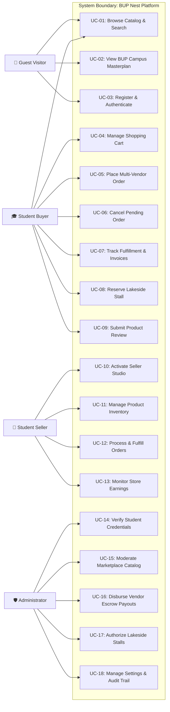

# Use Case Documentation & UML Modeling: BUP Nest

## 1. System Actors

| Actor | Type | Description |
|---|---|---|
| **Guest / Visitor** | Human (Unauthenticated) | Prospective students, alumni, or general public browsing the campus catalog, viewing the interactive BUP masterplan, and adding items to cart. |
| **Student Buyer** | Human (Authenticated) | Registered BUP student or faculty member placing orders, selecting campus drop-off points, tracking fulfillment, and reserving lakeside stalls. |
| **Student Seller / Vendor** | Human (Authenticated) | Student entrepreneur, club welfare team, or canteen concessionaire managing storefront listings, tracking stock, and fulfilling campus orders. |
| **Platform Administrator** | Human (Authenticated) | University authority or course moderator verifying student credentials, moderating catalog items, disbursing vendor payouts, and maintaining audit logs. |
| **BUP Nest System** | Automated / System | Background scheduler and database engine enforcing transaction concurrency, inventory deduction, and session validation. |

---

## 2. UML Use Case Diagram

---

## 3. Detailed Use Case Descriptions

### UC-05: Place Multi-Vendor Order
- **Use Case ID:** UC-05
- **Use Case Name:** Place Multi-Vendor Order with Campus Delivery
- **Primary Actor:** Student Buyer
- **Description:** A student buyer reviews their shopping cart, selects a BUP campus drop-off location, chooses a payment method (COD, bKash, Nagad), and submits the order. The system deducts inventory atomically and creates line items.
- **Preconditions:** Buyer is signed in with a valid session; cart contains at least one item; items are in stock.
- **Main Flow:**
  1. Buyer navigates to `/checkout`.
  2. System calculates subtotal, checks if buyer is verified student (applying discount if applicable), and adds campus delivery fee.
  3. Buyer selects campus drop-off zone (e.g., "BUP Vista Hall Gate 2") and provides recipient phone number.
  4. Buyer selects payment method (e.g., "bKash") and inputs the unique MFS Transaction ID (`paymentTrxId`).
  5. Buyer submits the order form.
  6. System initiates database transaction:
     - Verifies stock for each item (`stock >= quantity`).
     - Verifies `paymentTrxId` is not already used.
     - Deducts item stock in `products` table.
     - Inserts record into `orders` table.
     - Inserts individual line items into `order_items` table.
     - Commits transaction.
  7. System clears client shopping cart and redirects buyer to `/orders/[id]` with confirmation invoice.
- **Alternative Flow:**
  - *4a. Cash on Delivery (COD) selected:* No transaction ID is required; `payment_status` is set to `PENDING` and `payment_trx_id` remains `NULL`.
- **Exception Flow:**
  - *6a. Insufficient stock detected:* System aborts transaction, rolls back changes, and notifies buyer which product has sold out.
  - *6b. Duplicate TrxID detected:* System aborts transaction and prompts buyer that this transaction number has already been submitted.
- **Postconditions:** Order record is stored with status `PENDING`, inventory is decreased, and sellers receive notifications in their Seller Studio.

---

### UC-06: Self-Service Order Cancellation
- **Use Case ID:** UC-06
- **Use Case Name:** Cancel Pending Order & Restock Inventory
- **Primary Actor:** Student Buyer
- **Description:** A buyer cancels an unfulfilled order, prompting the system to mark the order as cancelled and restore the reserved inventory back to the sellers.
- **Preconditions:** Order belongs to the authenticated buyer; current order status is `PENDING`.
- **Main Flow:**
  1. Buyer opens `/orders` and clicks "Cancel Order" on a pending purchase.
  2. System validates order ownership (`buyer_id == session.user.id`) and verifies status is `PENDING`.
  3. System begins SQLite transaction:
     - Updates `orders.status` to `CANCELLED`.
     - Iterates through line items in `order_items` and increments `products.stock` by the purchased quantity.
     - Sets `products.in_stock = 1` if stock is greater than 0.
     - Commits transaction.
  4. System updates UI and notifies buyer of successful cancellation.
- **Exception Flow:**
  - *2a. Order already confirmed or shipped:* Cancellation button is disabled. System rejects request with message "Order is already being prepared or dispatched."
- **Postconditions:** Order status is `CANCELLED`; product stock is restored in the database.

---

### UC-12: Process & Fulfill Orders
- **Use Case ID:** UC-12
- **Use Case Name:** Fulfill Incoming Customer Order
- **Primary Actor:** Student Seller / Vendor
- **Description:** A vendor views customer purchases, confirms preparation, and marks items as dispatched/delivered.
- **Preconditions:** Seller is authenticated; customer has placed an order containing items sold by this vendor.
- **Main Flow:**
  1. Seller opens `/seller/orders`.
  2. System queries all orders containing items belonging to `seller.id`.
  3. Seller clicks "Confirm Order" to advance status from `PENDING` to `CONFIRMED`.
  4. Once dispatched via campus runner or handed over, seller advances status to `SHIPPED` and subsequently `DELIVERED`.
  5. System updates `orders.status` and logs timestamp.
- **Exception Flow:**
  - *3a. Unauthorized user attempts update:* Action guard verifies that the requesting user actually owns items in that order. Unmatched users are rejected.
- **Postconditions:** Order reaches terminal status `DELIVERED`; vendor payout becomes eligible for administrative disbursement.

---

### UC-14: Verify Student Credentials
- **Use Case ID:** UC-14
- **Use Case Name:** Verify Student Identity & Grant Campus Discount
- **Primary Actor:** Platform Administrator
- **Description:** Administrator reviews registered student ID numbers and departments against university roll sheets and toggles verification status.
- **Preconditions:** Admin is authenticated (`role == 'ADMIN'`).
- **Main Flow:**
  1. Admin opens `/admin/users` and filters by `Unverified`.
  2. Admin reviews student name, student ID, and departmental affiliation.
  3. Admin clicks "Verify Student" button.
  4. System sets `users.is_bup_verified = 1`.
  5. System logs action into `audit_logs` table (`action = 'VERIFY_STUDENT'`).
- **Postconditions:** Student account receives verified badge and qualifies for automatic student discounts during checkout.

---

### UC-16: Disburse Vendor Escrow Payouts
- **Use Case ID:** UC-16
- **Use Case Name:** Settle Vendor Escrow Payouts
- **Primary Actor:** Platform Administrator
- **Description:** Admin inspects accumulated sales for completed orders and disburses platform funds to the student vendor.
- **Preconditions:** Admin is authenticated; vendor has delivered orders marked `UNSETTLED`.
- **Main Flow:**
  1. Admin opens `/admin/payouts`.
  2. System computes gross sales, settled earnings, and pending escrow balances per vendor.
  3. Admin clicks "Bulk Settle Payouts" for a specific vendor and enters optional disbursement reference.
  4. System executes atomic update setting `seller_payout_status = 'SETTLED'` and `payout_notes` on all completed orders.
  5. System writes audit entry into `audit_logs` (`action = 'BULK_SETTLE_PAYOUTS'`).
- **Postconditions:** Vendor's unsettled liability balance resets to zero; orders are marked settled.
