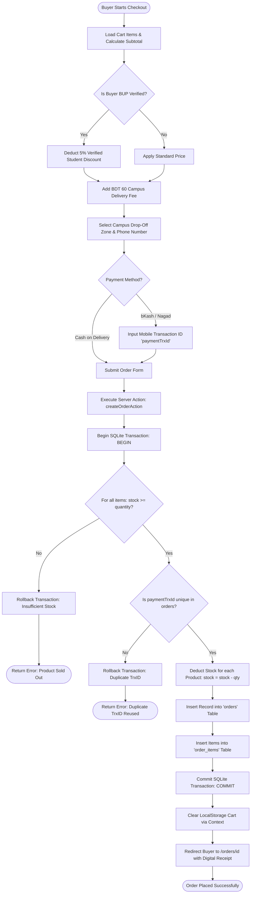
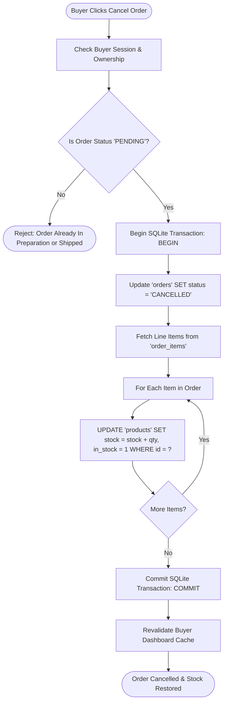
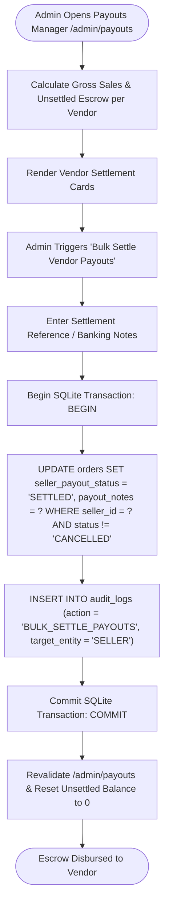
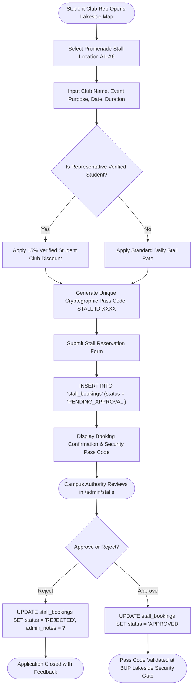

# Activity Diagrams and Workflow Models: BUP Nest

This document presents the detailed process workflows and activity diagrams for BUP Nest's critical operations.

---

## 1. End-to-End Order Placement & Concurrency Activity Flow

---

## 2. Order Cancellation & Stock Restoration Activity Flow

---

## 3. Administrative Escrow Settlement Workflow

---

## 4. Lakeside Pop-Up Stall Booking & Verification Workflow

