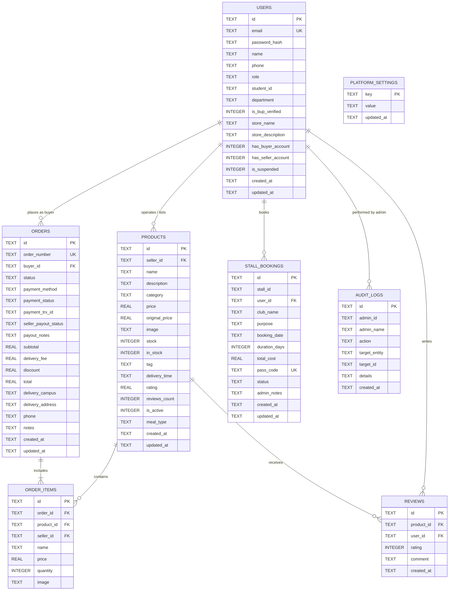

# Database Documentation & Data Architecture: BUP Nest

## 1. Database Architecture Overview
BUP Nest utilizes an embedded, zero-configuration relational database engine powered by Node.js native SQLite (`node:sqlite`). The physical database file is stored locally at `data/marketplace.db`.

### Key Characteristics:
- **Engine:** Node.js native `DatabaseSync` (`node:sqlite`).
- **Storage Mode:** Single-file persistent storage (`data/marketplace.db`).
- **Journal Mode:** Write-Ahead Logging (`PRAGMA journal_mode = WAL;`) for high concurrency between reader queries and writer transactions.
- **Foreign Key Enforcement:** `PRAGMA foreign_keys = ON;` is enforced at connection initialization.
- **Migration & Bootstrapping:** Schema initialization and automatic table/column migrations are managed on startup via `initDb()` in `lib/db.ts`.

---

## 2. Entity-Relationship (ER) Diagram



---

## 3. Detailed Table Schema Definitions

### 3.1 `users` Table
Stores user credentials, student profile information, roles, and store profiles.

| Column | Data Type | Constraints | Description |
|---|---|---|---|
| `id` | `TEXT` | PRIMARY KEY | Unique identifier (`cuid`). |
| `email` | `TEXT` | UNIQUE, NOT NULL | Account email address. |
| `password_hash` | `TEXT` | NOT NULL | Bcrypt hash (10 salt rounds). |
| `name` | `TEXT` | NOT NULL | Full name of student or vendor. |
| `phone` | `TEXT` | NULL | Contact phone number. |
| `role` | `TEXT` | NOT NULL, DEFAULT `'BUYER'` | Enum: `'BUYER'`, `'SELLER'`, `'ADMIN'`. |
| `student_id` | `TEXT` | NULL | Official BUP Student Roll Number. |
| `department` | `TEXT` | NULL | Academic department (e.g., ICE, CSE, BBA). |
| `is_bup_verified` | `INTEGER` | NOT NULL, DEFAULT 0 | 1 = verified student; 0 = unverified. |
| `store_name` | `TEXT` | NULL | Business / stall name for sellers. |
| `store_description`| `TEXT` | NULL | Overview of the seller's store. |
| `has_buyer_account`| `INTEGER` | NOT NULL, DEFAULT 1 | 1 = buyer enabled. |
| `has_seller_account`| `INTEGER` | NOT NULL, DEFAULT 0 | 1 = seller enabled. |
| `is_suspended` | `INTEGER` | NOT NULL, DEFAULT 0 | 1 = suspended; 0 = active. |
| `created_at` | `TEXT` | NOT NULL, DEFAULT `(datetime('now'))` | ISO timestamp of registration. |
| `updated_at` | `TEXT` | NOT NULL, DEFAULT `(datetime('now'))` | Timestamp of last update. |

---

### 3.2 `products` Table
Stores inventory items listed by vendors and student entrepreneurs.

| Column | Data Type | Constraints | Description |
|---|---|---|---|
| `id` | `TEXT` | PRIMARY KEY | Unique product ID (`cuid`). |
| `seller_id` | `TEXT` | NOT NULL, FK `users(id)` ON DELETE CASCADE | Seller user ID. |
| `name` | `TEXT` | NOT NULL | Product name. |
| `description` | `TEXT` | NOT NULL | Detailed item description. |
| `category` | `TEXT` | NOT NULL | Category: `merch`, `books`, `dining`, `tech`, `stationery`. |
| `price` | `REAL` | NOT NULL | Selling price in BDT. |
| `original_price` | `REAL` | NULL | Pre-discount strike-through price. |
| `image` | `TEXT` | NOT NULL | Image URL or relative path. |
| `stock` | `INTEGER` | NOT NULL, DEFAULT 0 | Available inventory units. |
| `in_stock` | `INTEGER` | NOT NULL, DEFAULT 1 | 1 = available; 0 = out of stock. |
| `tag` | `TEXT` | NULL | Badge: `'HOT'`, `'NEW'`, `'POPULAR'`, `'SALE'`. |
| `delivery_time` | `TEXT` | NOT NULL, DEFAULT `'1-2 days'` | Fulfillment speed estimate. |
| `rating` | `REAL` | NOT NULL, DEFAULT 5.0 | Dynamic aggregated review rating. |
| `reviews_count` | `INTEGER` | NOT NULL, DEFAULT 0 | Number of submitted reviews. |
| `is_active` | `INTEGER` | NOT NULL, DEFAULT 1 | 1 = active in store; 0 = delisted. |
| `meal_type` | `TEXT` | NULL | Meal slot: `'breakfast'`, `'lunch'`, `'snacks'`, `'dinner'`. |
| `created_at` | `TEXT` | NOT NULL, DEFAULT `(datetime('now'))` | ISO timestamp. |
| `updated_at` | `TEXT` | NOT NULL, DEFAULT `(datetime('now'))` | ISO timestamp. |

---

### 3.3 `orders` Table
Master ledger storing transaction details, fulfillment lifecycle, and payout statuses.

| Column | Data Type | Constraints | Description |
|---|---|---|---|
| `id` | `TEXT` | PRIMARY KEY | Unique order ID (`cuid`). |
| `order_number` | `TEXT` | UNIQUE, NOT NULL | Human-readable order code (e.g., `BUP-ORD-1001`). |
| `buyer_id` | `TEXT` | NOT NULL, FK `users(id)` ON DELETE RESTRICT | Buyer user ID. |
| `status` | `TEXT` | NOT NULL, DEFAULT `'PENDING'` | `'PENDING'`, `'CONFIRMED'`, `'SHIPPED'`, `'DELIVERED'`, `'CANCELLED'`. |
| `payment_method` | `TEXT` | NOT NULL, DEFAULT `'COD'` | `'COD'`, `'BKASH'`, `'NAGAD'`, `'CARD'`. |
| `payment_status` | `TEXT` | NOT NULL, DEFAULT `'PENDING'` | `'PENDING'`, `'PAID'`, `'FAILED'`, `'REFUNDED'`. |
| `payment_trx_id` | `TEXT` | NULL | Unique MFS transaction ID. |
| `seller_payout_status`| `TEXT`| NOT NULL, DEFAULT `'UNSETTLED'` | `'UNSETTLED'`, `'SETTLED'`, `'HELD'`. |
| `payout_notes` | `TEXT` | NULL | Administrative escrow settlement notes. |
| `subtotal` | `REAL` | NOT NULL | Item subtotal in BDT. |
| `delivery_fee` | `REAL` | NOT NULL, DEFAULT 60 | Campus delivery fee in BDT. |
| `discount` | `REAL` | NOT NULL, DEFAULT 0 | Verified student discount deduction. |
| `total` | `REAL` | NOT NULL | Net payable total in BDT. |
| `delivery_campus`| `TEXT` | NOT NULL, DEFAULT `'BUP Main Campus'` | Campus identifier. |
| `delivery_address`| `TEXT` | NOT NULL | Campus drop-off zone. |
| `phone` | `TEXT` | NOT NULL | Recipient contact phone number. |
| `notes` | `TEXT` | NULL | Special delivery instructions. |
| `created_at` | `TEXT` | NOT NULL, DEFAULT `(datetime('now'))` | ISO timestamp. |
| `updated_at` | `TEXT` | NOT NULL, DEFAULT `(datetime('now'))` | ISO timestamp. |

---

### 3.4 `order_items` Table
Line items associated with each order, linking products and individual vendors.

| Column | Data Type | Constraints | Description |
|---|---|---|---|
| `id` | `TEXT` | PRIMARY KEY | Unique line item ID (`cuid`). |
| `order_id` | `TEXT` | NOT NULL, FK `orders(id)` ON DELETE CASCADE | Parent order ID. |
| `product_id` | `TEXT` | NOT NULL, FK `products(id)` ON DELETE RESTRICT | Ordered product ID. |
| `seller_id` | `TEXT` | NOT NULL, FK `users(id)` ON DELETE RESTRICT | Seller user ID. |
| `name` | `TEXT` | NOT NULL | Snapshot of product name at purchase. |
| `price` | `REAL` | NOT NULL | Price charged per unit. |
| `quantity` | `INTEGER` | NOT NULL | Number of units purchased. |
| `image` | `TEXT` | NOT NULL | Product image snapshot. |

---

### 3.5 `stall_bookings` Table
Physical pop-up stall space reservations near the BUP Lake Promenade.

| Column | Data Type | Constraints | Description |
|---|---|---|---|
| `id` | `TEXT` | PRIMARY KEY | Unique booking ID (`cuid`). |
| `stall_id` | `TEXT` | NOT NULL | Spatial location code (e.g., `'stall-1'`). |
| `user_id` | `TEXT` | NOT NULL, FK `users(id)` ON DELETE CASCADE | Reserving club representative ID. |
| `club_name` | `TEXT` | NOT NULL | Official club or organization name. |
| `purpose` | `TEXT` | NOT NULL | Event or showcase description. |
| `booking_date` | `TEXT` | NOT NULL | Date of reservation (`YYYY-MM-DD`). |
| `duration_days` | `INTEGER` | NOT NULL, DEFAULT 1 | Number of active reservation days. |
| `total_cost` | `REAL` | NOT NULL | Calculated reservation fee in BDT. |
| `pass_code` | `TEXT` | UNIQUE, NOT NULL | Alphanumeric gate access code. |
| `status` | `TEXT` | NOT NULL, DEFAULT `'PENDING_APPROVAL'` | `'PENDING_APPROVAL'`, `'APPROVED'`, `'REJECTED'`, `'COMPLETED'`. |
| `admin_notes` | `TEXT` | NULL | Moderation notes or gate instructions. |
| `created_at` | `TEXT` | NOT NULL, DEFAULT `(datetime('now'))` | ISO timestamp. |
| `updated_at` | `TEXT` | NOT NULL, DEFAULT `(datetime('now'))` | ISO timestamp. |

---

### 3.6 `audit_logs` Table
Immutable chronicle of all administrative interventions and governance actions.

| Column | Data Type | Constraints | Description |
|---|---|---|---|
| `id` | `TEXT` | PRIMARY KEY | Unique log entry ID (`cuid`). |
| `admin_id` | `TEXT` | NOT NULL | Admin user ID who performed action. |
| `admin_name` | `TEXT` | NOT NULL | Full name of the acting administrator. |
| `action` | `TEXT` | NOT NULL | Action code (e.g., `'VERIFY_STUDENT'`, `'SETTLE_PAYOUT'`). |
| `target_entity` | `TEXT` | NOT NULL | Entity type: `'USER'`, `'PRODUCT'`, `'ORDER'`, `'STALL'`, `'PLATFORM'`. |
| `target_id` | `TEXT` | NOT NULL | ID of affected entity record. |
| `details` | `TEXT` | NULL | Human-readable description of change. |
| `created_at` | `TEXT` | NOT NULL, DEFAULT `(datetime('now'))` | ISO timestamp. |

---

### 3.7 `platform_settings` Table
Key-value configuration store for campus broadcast announcements and marketplace fees.

| Column | Data Type | Constraints | Description |
|---|---|---|---|
| `key` | `TEXT` | PRIMARY KEY | Configuration key (e.g., `'announcement_banner'`). |
| `value` | `TEXT` | NOT NULL | Serialized or string value. |
| `updated_at` | `TEXT` | NOT NULL, DEFAULT `(datetime('now'))` | ISO timestamp. |

---

## 4. Indexing Strategy
To optimize high-frequency queries and joins, the following explicit indexes are maintained:
```sql
CREATE INDEX IF NOT EXISTS idx_products_seller ON products(seller_id);
CREATE INDEX IF NOT EXISTS idx_products_category ON products(category);
CREATE INDEX IF NOT EXISTS idx_orders_buyer ON orders(buyer_id);
CREATE INDEX IF NOT EXISTS idx_order_items_seller ON order_items(seller_id);
CREATE INDEX IF NOT EXISTS idx_stall_bookings_user ON stall_bookings(user_id);
CREATE INDEX IF NOT EXISTS idx_audit_logs_created ON audit_logs(created_at);
```
