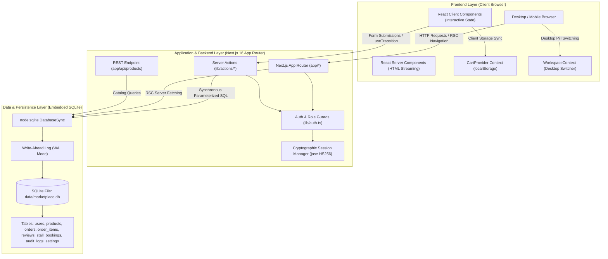
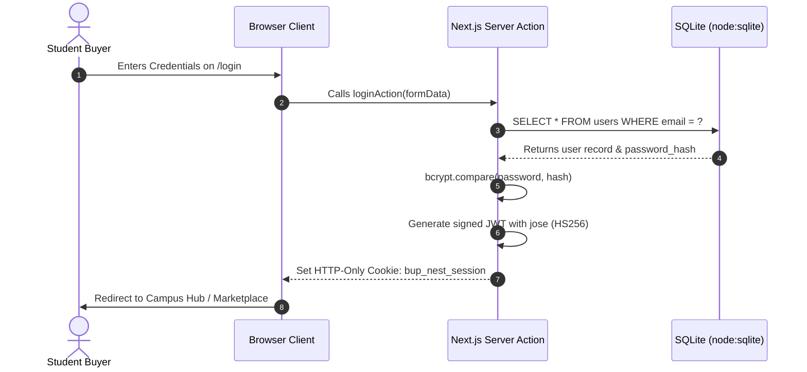

# System Architecture & Component Interaction: BUP Nest

## 1. Architectural Overview
BUP Nest is designed around a modern full-stack hybrid architecture utilizing **Next.js 16 (App Router)** and **React 19**. It leverages **React Server Components (RSC)** for data-intensive server rendering alongside client-side React boundaries for reactive UI interactions.

All database mutations and authenticated operations are executed via **Next.js Server Actions**, eliminating the maintenance burden of separate REST controllers while maintaining strong end-to-end TypeScript type safety.

---

## 2. Layered Architecture Diagram

---

## 3. Detailed Architectural Layers

### 3.1 Frontend Presentation Layer
- **React Server Components (RSC):** Default component paradigm. Pages (`/`, `/shop`, `/product/[id]`, `/orders`, `/admin/*`) fetch data directly on the server without client-side API roundtrips.
- **Client Components (`'use client'`):** Reserved for interactive interactive elements such as `CartProvider.tsx`, `StallBookingModal.tsx`, `WorkspaceHeader.tsx`, and admin action buttons (`UserActionButtons.tsx`, `OrderActionButtons.tsx`, etc.).
- **Styling Architecture:** Built on Tailwind CSS v4 using modern CSS directives (`@theme`), responsive flexbox/grid containers, and campus-themed design tokens (`#213527`, `#392525`, `#E3E890`, `#FAF5E9`).

### 3.2 Backend & Application Logic Layer
- **Server Actions:** All data mutations (sign-in, checkout, cancellation, inventory updates, admin verifications, escrow disbursements) are implemented as asynchronous Server Actions in `lib/actions/`.
- **Stateless Cryptographic Authentication:** Sessions are maintained via signed JWT tokens stored in HTTP-only cookies (`bup_nest_session`). Session tokens are signed using HMAC-SHA256 (`jose`) with secret `JWT_SECRET`.
- **Role-Based Guards:**
  - `getCurrentUser()`: Resolves session and fetches user record.
  - `requireAdmin()`: Enforces `user.role === 'ADMIN'`.
  - `requireSeller()`: Enforces `user.has_seller_account === 1`.

### 3.3 Database & Storage Layer
- **Embedded Node.js SQLite (`node:sqlite`):** BUP Nest runs directly on Node.js's native `DatabaseSync` class.
- **Transaction Safety:** Multi-step operations (e.g., placing orders with stock decrements, cancelling orders with stock increments, and bulk escrow settlements) are wrapped in explicit database transactions (`BEGIN` ... `COMMIT`).
- **Referential Integrity:** Enforced via `PRAGMA foreign_keys = ON;` and `ON DELETE CASCADE / RESTRICT` constraints.

---

## 4. Authentication & Data Flow

---

## 5. Security & Isolation Boundaries
1. **Zero Secret Leakage:** Database credentials and signing keys are read strictly from server-side environment variables (`process.env.JWT_SECRET`).
2. **SQL Injection Defense:** All SQL operations use parameterized placeholders (`?`). String concatenation is strictly prohibited.
3. **Client-Server Boundary:** Sensitive backend modules (`node:sqlite`, `bcryptjs`, `jose`) are restricted to server bundles via Next.js RSC separation.
